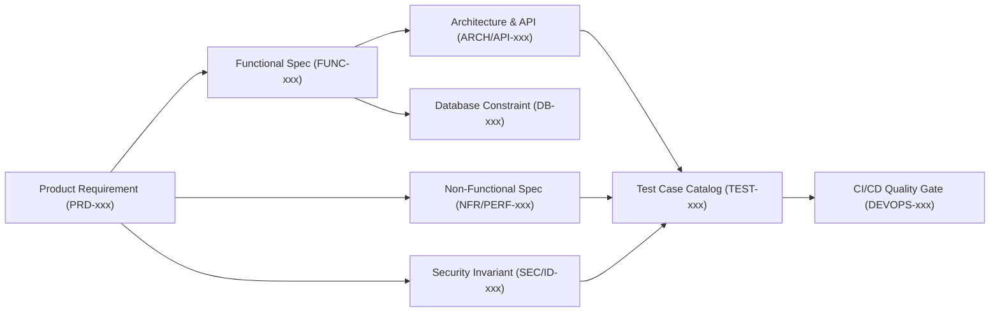

# Master Documentation Index & Traceability Register — OI (Oy / Oi)

> **Document ID:** DOC-IDX-001  
> **Status:** Stage 1 Approved Baseline / Continuously Updated  
> **Last Updated:** 2026-11-07  
> **Project Repository:** `https://github.com/shanuthchimbli/oisocialapp`  
> **Author:** Architecture & Quality Engineering Group  

---

## 1. Document Inventory & Staged Roadmap

The following table provides the exhaustive index of all formal specifications comprising the **OI** messaging application engineering baseline. Every document adheres strictly to the standard document template: Purpose, Scope, Definitions, Requirements, Technical Considerations, Security Implications, Dependencies, Acceptance Criteria, Open Questions, References, and Version History.

| File Path | Title / Subject Matter | Stage | Status | Primary Stakeholder |
| :--- | :--- | :---: | :---: | :--- |
| [`README.md`](file:///Users/shanuthchimbli/.gemini/antigravity/scratch/oisocialapp/README.md) | Project Overview & Development Guidelines | 1 | Confirmed | All Stakeholders |
| [`DOCUMENTATION_INDEX.md`](file:///Users/shanuthchimbli/.gemini/antigravity/scratch/oisocialapp/DOCUMENTATION_INDEX.md) | Master Index & Traceability Register | 1 | Confirmed | Lead Architect / QA |
| [`GLOSSARY.md`](file:///Users/shanuthchimbli/.gemini/antigravity/scratch/oisocialapp/GLOSSARY.md) | Standard Terminology & Cryptographic Notation | 1 | Confirmed | Engineering & Product |
| [`CONTRIBUTING.md`](file:///Users/shanuthchimbli/.gemini/antigravity/scratch/oisocialapp/CONTRIBUTING.md) | Documentation Authoring & Governance Standards | 1 | Confirmed | Core Contributors |
| [`CHANGELOG.md`](file:///Users/shanuthchimbli/.gemini/antigravity/scratch/oisocialapp/CHANGELOG.md) | Iteration & Milestone Audit Trail | 1 | Confirmed | Product Owner |
| [`docs/00_PROJECT_CHARTER.md`](file:///Users/shanuthchimbli/.gemini/antigravity/scratch/oisocialapp/docs/00_PROJECT_CHARTER.md) | Project Charter, Vision, Scope Boundaries & RACI | 1 | Confirmed | Product Owner |
| [`docs/01_PRODUCT_REQUIREMENTS.md`](file:///Users/shanuthchimbli/.gemini/antigravity/scratch/oisocialapp/docs/01_PRODUCT_REQUIREMENTS.md) | Product Requirements Document (PRD) & Invariants | 1 | Confirmed | Product Owner / BA |
| [`docs/02_FUNCTIONAL_REQUIREMENTS.md`](file:///Users/shanuthchimbli/.gemini/antigravity/scratch/oisocialapp/docs/02_FUNCTIONAL_REQUIREMENTS.md) | Functional Requirements Specification (FRS) | 2 | Proposed | Lead Architect / Dev |
| [`docs/03_USER_FLOWS.md`](file:///Users/shanuthchimbli/.gemini/antigravity/scratch/oisocialapp/docs/03_USER_FLOWS.md) | End-to-End User Journeys & State Transitions | 2 | Proposed | UI/UX / Mobile Lead |
| [`docs/04_NON_FUNCTIONAL_REQUIREMENTS.md`](file:///Users/shanuthchimbli/.gemini/antigravity/scratch/oisocialapp/docs/04_NON_FUNCTIONAL_REQUIREMENTS.md) | Non-Functional Requirements & Performance SLOs | 2 | Proposed | Performance Architect |
| [`docs/05_IDENTITY_AND_VERIFICATION.md`](file:///Users/shanuthchimbli/.gemini/antigravity/scratch/oisocialapp/docs/05_IDENTITY_AND_VERIFICATION.md) | Government Identity Verification Systems (IN, UK, US)| 2 | Requires Legal/Tech Validation | Security / Legal |
| [`docs/06_SECURITY_AND_PRIVACY.md`](file:///Users/shanuthchimbli/.gemini/antigravity/scratch/oisocialapp/docs/06_SECURITY_AND_PRIVACY.md) | Security Baseline, Privacy & Data Minimization | 3 | Proposed | Security Architect |
| [`docs/07_END_TO_END_ENCRYPTION.md`](file:///Users/shanuthchimbli/.gemini/antigravity/scratch/oisocialapp/docs/07_END_TO_END_ENCRYPTION.md) | Cryptographic Protocol & Key Management Lifecycle | 3 | Proposed | Cryptographer / Security |
| [`docs/08_SYSTEM_ARCHITECTURE.md`](file:///Users/shanuthchimbli/.gemini/antigravity/scratch/oisocialapp/docs/08_SYSTEM_ARCHITECTURE.md) | Distributed Architecture, WebSockets & Microservices | 4 | Proposed | Lead Systems Architect |
| [`docs/09_DATABASE_DESIGN.md`](file:///Users/shanuthchimbli/.gemini/antigravity/scratch/oisocialapp/docs/09_DATABASE_DESIGN.md) | Data Models, Constraints, ERDs & Retention Purge | 4 | Proposed | Database Architect |
| [`docs/10_API_AND_REALTIME_PROTOCOL.md`](file:///Users/shanuthchimbli/.gemini/antigravity/scratch/oisocialapp/docs/10_API_AND_REALTIME_PROTOCOL.md) | REST APIs, WebSocket Framing & Error Contracts | 4 | Proposed | Backend / Mobile Lead |
| [`docs/11_ANDROID_ARCHITECTURE.md`](file:///Users/shanuthchimbli/.gemini/antigravity/scratch/oisocialapp/docs/11_ANDROID_ARCHITECTURE.md) | Native Android Kotlin / Compose / Room Architecture | 4 | Proposed | Android Lead |
| [`docs/12_IOS_PORTABILITY.md`](file:///Users/shanuthchimbli/.gemini/antigravity/scratch/oisocialapp/docs/12_IOS_PORTABILITY.md) | Cross-Platform Protocol Parity & iOS Strategy | 4 | Proposed | iOS Architect |
| [`docs/13_TESTING_STRATEGY.md`](file:///Users/shanuthchimbli/.gemini/antigravity/scratch/oisocialapp/docs/13_TESTING_STRATEGY.md) | End-to-End Quality Engineering Framework | 5 | Proposed | QA Architect |
| [`docs/14_TEST_CASE_CATALOG.md`](file:///Users/shanuthchimbli/.gemini/antigravity/scratch/oisocialapp/docs/14_TEST_CASE_CATALOG.md) | 100+ Cataloged Formal Verification Scenarios | 5 | Proposed | QA Architect / SDET |
| [`docs/15_PERFORMANCE_TESTING.md`](file:///Users/shanuthchimbli/.gemini/antigravity/scratch/oisocialapp/docs/15_PERFORMANCE_TESTING.md) | Benchmarks, Profiling, Cold Starts & Battery Profiling | 5 | Proposed | Performance Engineer |
| [`docs/16_CODE_QUALITY.md`](file:///Users/shanuthchimbli/.gemini/antigravity/scratch/oisocialapp/docs/16_CODE_QUALITY.md) | Static Analysis, Linting, Architecture Rules & Gates | 6 | Proposed | Lead Developer |
| [`docs/17_CI_CD_PIPELINE.md`](file:///Users/shanuthchimbli/.gemini/antigravity/scratch/oisocialapp/docs/17_CI_CD_PIPELINE.md) | GitHub Actions Automation, Security Scanning & Gates | 6 | Proposed | DevOps / Release Eng |
| [`docs/18_INFRASTRUCTURE_AND_COSTS.md`](file:///Users/shanuthchimbli/.gemini/antigravity/scratch/oisocialapp/docs/18_INFRASTRUCTURE_AND_COSTS.md) | Cloud Infrastructure, Topology & Cost Model Ledger | 6 | Proposed | Cloud Architect / FinOps |
| [`docs/19_DEPLOYMENT_AND_RELEASE.md`](file:///Users/shanuthchimbli/.gemini/antigravity/scratch/oisocialapp/docs/19_DEPLOYMENT_AND_RELEASE.md) | Release Engineering, Play Store Signing & Rollout | 6 | Proposed | Release Manager |
| [`docs/20_MONITORING_AND_MAINTENANCE.md`](file:///Users/shanuthchimbli/.gemini/antigravity/scratch/oisocialapp/docs/20_MONITORING_AND_MAINTENANCE.md) | Telemetry, SLO Observability, Runbooks & SRE | 6 | Proposed | SRE / DevOps |
| [`docs/21_THREAT_MODEL_AND_RISKS.md`](file:///Users/shanuthchimbli/.gemini/antigravity/scratch/oisocialapp/docs/21_THREAT_MODEL_AND_RISKS.md) | STRIDE Threat Model, Attack Surfaces & Mitigations | 3 | Proposed | Security Architect |
| [`docs/22_DECISION_LOG.md`](file:///Users/shanuthchimbli/.gemini/antigravity/scratch/oisocialapp/docs/22_DECISION_LOG.md) | Architectural Decision Records (ADRs) | 1–7 | Continuously Updated | Lead Architect |
| [`docs/23_OPEN_QUESTIONS.md`](file:///Users/shanuthchimbli/.gemini/antigravity/scratch/oisocialapp/docs/23_OPEN_QUESTIONS.md) | Product Owner Decision & Clarification Queue | 1–7 | Continuously Updated | Product Owner |

---

## 2. Requirement Taxonomy & Traceability Matrix Structure

Every technical specification and test case traces directly back to a parent Product Requirement (`PRD-xxx`). No orphaned requirements or speculative engineering tasks are permitted.

### Traceability Index Sample (Stage 1 Invariants)

| Product Req (`PRD-xxx`) | Domain / Description | Downstream Functional (`FUNC`) | Architectural Module | Verification Scenario (`TEST`) |
| :--- | :--- | :--- | :--- | :--- |
| **PRD-001** | One Verified Person, One Account | `FUNC-ID-001`, `FUNC-ID-003` | Identity Verification Engine, Anonymized Hash Index | `TEST-ID-001` to `TEST-ID-012` |
| **PRD-002** | International Phone Authentication | `FUNC-AUTH-001`, `FUNC-AUTH-004` | Auth Service, Twilio/AWS SMS, Redis Rate-Limiter | `TEST-AUTH-001` to `TEST-AUTH-015` |
| **PRD-003** | Government-Only Identity Verification | `FUNC-ID-002`, `FUNC-ID-005` | UIDAI Offline XML / OneID / Gov Portals | `TEST-GOV-001` to `TEST-GOV-020` |
| **PRD-004** | Globally Unique, Changeable Usernames | `FUNC-USR-001`, `FUNC-USR-003` | User Service, PostgreSQL Citext Index | `TEST-USR-001` to `TEST-USR-010` |
| **PRD-005** | Single Active Device Enforcement | `FUNC-DEV-001`, `FUNC-DEV-003` | Session Manager, JWT Revocation, FCM Wakeup | `TEST-DEV-001` to `TEST-DEV-010` |
| **PRD-006** | Zero-Plaintext End-to-End Encryption | `FUNC-CRYPTO-001` to `FUNC-CRYPTO-006` | Signal Double Ratchet Engine, Room SQLCipher | `TEST-E2EE-001` to `TEST-E2EE-025` |
| **PRD-007** | Strict 365-Day Message Purge | `FUNC-RET-001`, `FUNC-RET-004` | Retention Purge Worker, Room Auto-Vacuum | `TEST-RET-001` to `TEST-RET-010` |
| **PRD-008** | Text-Only Status Updates | `FUNC-STAT-001` to `FUNC-STAT-005` | Ephemeral Status Store, Cryptographic Ring | `TEST-STAT-001` to `TEST-STAT-008` |
| **PRD-009** | Text-Only 1-to-1 Messaging | `FUNC-MSG-001` to `FUNC-MSG-010` | WebSocket Pipeline, Offline Queue, Room DB | `TEST-MSG-001` to `TEST-MSG-030` |
| **PRD-010** | Radical Performance & Zero Lag | `PERF-001` to `PERF-007` | Jetpack Compose, Local-First Engine, Redis PubSub | `TEST-PERF-001` to `TEST-PERF-015` |
