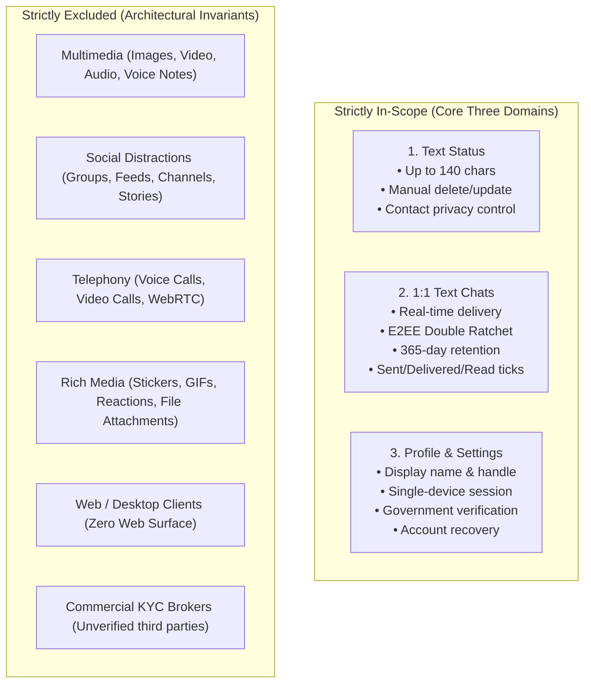

# Project Charter: OI (Oy / Oi) — Verified Identity-Based Messaging Application

> **Document ID:** CHARTER-001  
> **Status:** Stage 1 Baseline — Confirmed & Proposed Baseline  
> **Last Updated:** 2026-11-07  
> **Project Repository:** `https://github.com/shanuthchimbli/oisocialapp`  
> **Author:** Senior Software Architect, Security Architect, QA & DevOps Team  
> **Target Audience:** Product Owner, Lead Architect, Engineering Leads  

---

## 1. Executive Summary & Brand Purpose

The purpose of this Project Charter is to formally establish the scope, objectives, architectural principles, governance model, and operational constraints for **OI** (stylized as **OI**, culturally pronounced *"Oy"* / *"Oi"*, meaning *"Hey!"*).

Modern digital messaging is plagued by systemic dysfunctions: anonymous burner accounts, malicious bot syndicates, romance scams, phishing campaigns, impersonation, multimedia sensory overload, and invasive surveillance monetization. **OI** is engineered as a high-integrity, zero-compromise alternative. By anchoring every communication account to an independently verified, authoritative government identity record, the platform restores digital trust while upholding uncompromising end-to-end cryptographic privacy.

---

## 2. Core Product Vision & 12 Architectural Differentiators

The application is guided by 12 non-negotiable architectural differentiators:

1. **One Verified Person, One Account:** Cryptographically enforced 1:1 parity between a verified living human being and an active messaging account. Zero multi-accounting, zero bots, zero anonymous burner profiles.
2. **International Phone-Number Registration:** Authoritative phone-bound registration with mandatory SMS OTP verification across initial tier-1 territories (India +91, UK +44, US +1) with deterministic global expansion.
3. **Government-System-Only Identity Verification:** Sole reliance on legally sanctioned, sovereign, state-operated identity systems (e.g., UIDAI Offline XML in India, GOV.UK One Login in the UK, NIST-compliant state trust frameworks in the US). Zero reliance on commercial, unvetted KYC brokers.
4. **Unique Username for Every Account:** Globally unique, human-readable handle enforced by database-level constraints. Permanent internal account IDs decouple identity from mutable usernames.
5. **Controlled Username Modification Policy:** Usernames may be updated under strict rate-limiting, audit logging, and impersonation-prevention policies.
6. **Strict One Active Device Enforcement:** An account may possess exactly one active authenticated session. A new login immediately and irrevocably terminates previous device sessions and revokes local ratchets.
7. **Zero-Knowledge End-to-End Encryption (E2EE):** All 1:1 messages and private text status updates use industry-standard cryptographic ratcheting (Signal Double Ratchet + Curve25519 + AES-256-GCM). The server relay retains zero plaintext.
8. **Enforced 365-Day Message Retention Policy:** Mathematical expiration of message data across server queues and client local storage exactly 365 days after creation timestamp.
9. **Text-Only Status Updates:** Minimalist, text-only broadcast status. No photo stories, video reels, background music, or stickers. Status persists until explicitly replaced or deleted.
10. **Text-Only One-to-One Messaging:** Pure textual conversation. No group chats, images, audio clips, voice notes, stickers, GIFs, voice calling, or video conferencing.
11. **Extreme Engineering Performance:** Local-first architecture engineered for sub-second cold starts, 60 FPS scrolling, sub-50ms optimistic local rendering, and sub-500ms p95 global message delivery.
12. **Radical Minimalism & Anti-Distraction:** Elimination of algorithmic feeds, engagement traps, channels, read-status social surveillance, and unnecessary bloatware.

---

## 3. Scope Boundaries: Inclusions vs. Strict Exclusions

### 3.1 Strict Inclusions
- **Status Domain:** Persistent text-only status; manual update/deletion; contact-level privacy filtering; blocked user isolation.
- **Chat Domain:** Real-time bi-directional 1:1 text messaging; cryptographic delivery receipts (Sent, Delivered, Read); offline SQLite/Room message queuing; local full-text search; automatic reconnection and replay deduplication; user blocking and abuse reporting.
- **Profile & Account Domain:** Display name configuration; unique username management; phone number association; single-device session oversight; government verification status indicators; 14-day grace period enforcement; secure cryptographic account recovery.

### 3.2 Strict Exclusions
- **NO Multimedia:** Images, audio messages, voice notes, video clips, documents, PDF/file transfer, stickers, animated emojis, or GIFs.
- **NO Group Communications:** No multi-party chats, broadcast lists, channels, or communities.
- **NO Real-Time Telephony:** No voice-over-IP (VoIP) or video calling infrastructure.
- **NO Social Mechanics:** No timeline feeds, like buttons, comment threads, public discovery directories, or read-time surveillance.
- **NO Web Client:** The platform will **never** have a Web client. The threat surface of browser-based WebCrypto, DOM XSS, and unauthenticated device hijacking is completely eliminated.

---

## 4. Platform & Technology Strategy

### Phase 1: Native Android Release (Mandatory Priority)
- **Language & Runtime:** Kotlin 2.x, targeting Android 8.0+ (API level 26+).
- **UI Framework:** Jetpack Compose (Declarative UI, zero legacy XML views).
- **Architecture:** Local-first Clean Architecture with MVI (Model-View-Intent) pattern.
- **Local Persistence:** Room Database over SQLCipher (Hardware-backed AES-256-GCM encryption).
- **Key Storage:** Android Keystore System (Hardware TEE / StrongBox Keymaster).
- **Networking:** Ktor / OkHttp with TLS 1.3 certificate pinning and binary WebSockets.

### Phase 2: Native iOS Portability (Zero Backend Rewrite)
- **Language & Runtime:** Swift 6, targeting iOS 16+.
- **UI Framework:** SwiftUI.
- **Architectural Parity:** The backend, API contracts, WebSocket frames, database invariants, and cryptographic handshake protocols are strictly platform-agnostic. The iOS application will consume identical endpoints and protocols without backend refactoring.

### Phase 3: Shared Backend & Core Engine
- **Core API & WebSocket Relay:** High-throughput, memory-safe backend (Go or Rust) running lightweight containerized services.
- **Primary Data Store:** PostgreSQL 16+ with strict relational constraints, citext, and btree/gin indexing.
- **In-Memory Cache & Session Broker:** Redis Cluster 7+ for ephemeral socket routing, pub/sub, rate-limiting, and presence caching.
- **Push Notification Infrastructure:** Data-only push via Firebase Cloud Messaging (FCM) for Android and Apple Push Notification service (APNs) for iOS. No message plaintext is ever sent via push payloads.

---

## 5. Governance, Roles & RACI Matrix

The Product Owner serves as the ultimate arbiter of all functional and business decisions. Engineering cannot make silent deviations from stated product invariants.

| Role | Primary Responsibility | Incumbent / Delegate |
| :--- | :--- | :--- |
| **Product Owner (PO)** | Final authority on product scope, trade-offs, legal risks, and release approval. | User / Product Owner |
| **Lead Software Architect** | Technical feasibility, modular design, contract stability, cross-platform architecture. | Antigravity AI Engine |
| **Security & Privacy Architect**| Threat modeling (STRIDE), cryptographic protocol validation, zero-knowledge enforcement. | Antigravity AI Engine |
| **QA Architect & SDET** | Automated test strategy, 100+ scenario verification, CI/CD quality gate enforcement. | Antigravity AI Engine |
| **Performance Engineer** | Latency budgets (p50/p95/p99), memory profiling, battery consumption optimization. | Antigravity AI Engine |
| **DevOps & Release Engineer** | CI/CD automation, Infrastructure as Code, signing keys, zero-touch deployment. | Antigravity AI Engine |

---

## 6. Project Assumptions, Constraints & Dependencies

### 6.1 Critical Assumptions
1. Authoritative sovereign identity verification can be integrated legally without violating data-localization or privacy statutes.
2. In tier-1 jurisdictions (India, UK, US), cryptographic or statutory identity validation can yield an immutable, privacy-preserving deduplication token (e.g., blinded hash) without retaining prohibited government identifiers.
3. Users operate smartphones equipped with hardware-backed keystores (TEE / Secure Enclave).

### 6.2 Hard Technical & Operational Constraints
1. **Single Developer Operational Viability:** The entire backend and mobile architecture must be maintainable, testable, and deployable by a single primary full-stack engineer utilizing automated CI/CD and self-healing infrastructure.
2. **Zero Plaintext Invariant:** The database and operational team have mathematically zero capability to decrypt user chats or text statuses.
3. **No Commercial KYC Substitutes:** The Product Owner explicitly forbids delegating identity validation to commercial, unregulated third-party KYC vendors.

---

## 7. High-Level Risk Assessment & Mitigation Matrix

| Risk ID | Risk Description | Severity | Probability | Mitigation Strategy |
| :--- | :--- | :---: | :---: | :--- |
| **RSK-001** | Private entities legally barred from direct UIDAI/Aadhaar biometric/OTP API integration in India. | Critical | High | Architect offline paperless e-KYC (digitally signed XML / Secure QR) where the resident generates their own share-code-protected package from official UIDAI portals. |
| **RSK-002** | Absence of unified federal digital identity API in the United States. | High | High | Define multi-state mDL (ISO/IEC 18013-5) and Login.gov / NIST IAL2 verification frameworks; identify state-by-state constraints. |
| **RSK-003** | SIM-swap attacks intercepting SMS OTP registration codes. | High | Medium | Enforce mandatory second-factor re-verification against government identity token whenever a phone number migration occurs. |
| **RSK-004** | Client-side memory or storage leakage of 365-day expired messages. | High | Medium | Implement automated SQLite VACUUM and zeroize cryptographic ratchet keys upon reaching 365-day delta; enforce OS background workers. |
| **RSK-005** | Scalability bottleneck on single-instance WebSocket broker. | Medium | Medium | Employ Redis Pub/Sub cluster with stateless Go/Rust socket relays and horizontal auto-scaling. |
