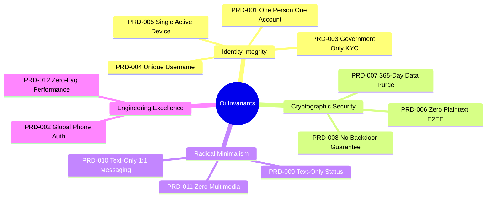
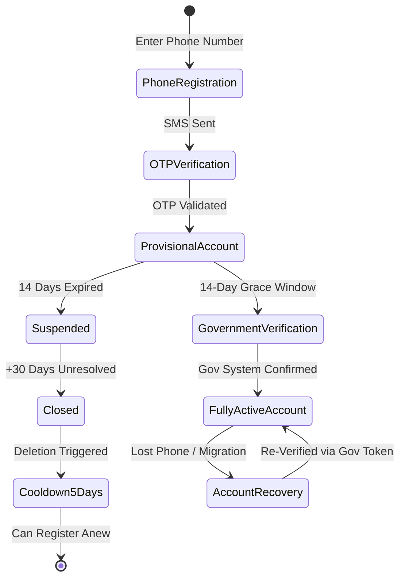

# Product Requirements Document (PRD): Oi — Verified Identity-Based Messaging Application

> **Document ID:** PRD-001-CORE  
> **Status:** Stage 1 Baseline — Confirmed & Proposed Baseline  
> **Last Updated:** 2026-11-07  
> **Project Repository:** `https://github.com/shanuthchimbli/oisocialapp`  
> **Author:** Senior Product Analyst & Software Architect  
> **Reviewer:** Product Owner  

---

## 1. Document Overview & Purpose

This Product Requirements Document (PRD) defines the functional boundaries, core product invariants, user personas, operational constraints, and acceptance criteria for **Oi** (culturally inspired by the greeting *"Oy"* / *"Oi"*, meaning *"Hey!"*). It translates the high-level Product Charter into unambiguous, verifiable engineering requirements. Every requirement in this document carries a permanent identifier (`PRD-xxx`) and serves as the authoritative source of truth for architectural designs, database schemas, API contracts, and automated test scenarios.

---

## 2. Core Product Invariants & Strategic Requirements

The application is architected around 12 absolute product invariants:

### PRD-001: One Verified Person, One Active Account (OPOA)
- **Requirement:** A single verified living human being may possess exactly one active messaging account across the global network at any time.
- **Invariant:** Duplicate registrations using the same underlying government identity record must be cryptographically detected and rejected.
- **Traceability:** Implemented via `FUNC-ID-001`, verified via `TEST-ID-001` through `TEST-ID-012`.

### PRD-002: International Phone Number Authentication
- **Requirement:** Initial registration requires verification of a valid mobile telephone number via high-security SMS OTP.
- **Initial Supported Territories:**
  - India (`+91`)
  - United Kingdom (`+44`)
  - United States (`+1`)
- **Extensibility:** The telephone parser and routing subsystem must support deterministic expansion to any E.164-compliant international country code.
- **Traceability:** Implemented via `FUNC-AUTH-001`, verified via `TEST-AUTH-001` through `TEST-AUTH-015`.

### PRD-003: Sovereign Government-System-Only Identity Verification
- **Requirement:** Identity validation is restricted exclusively to official, legally sanctioned, government-operated identity verification systems.
- **Zero Commercial KYC:** Generic commercial identity aggregation vendors, unvetted credit bureaus, and proprietary biometric brokers are strictly prohibited.
- **Traceability:** Implemented via `FUNC-ID-002`, verified via `TEST-GOV-001` through `TEST-GOV-020`.

### PRD-004: Globally Unique, Changeable Usernames
- **Requirement:** Every account must be identified publicly by an alphanumeric handle that is globally unique across the platform.
- **Decoupling Invariant:** The permanent internal account identifier (`UUIDv7`) is immutable. The username is a mutable pointer.
- **Controlled Modification:** Usernames may be modified only under strict rate-limiting, audit trails, and anti-impersonation rules.
- **Traceability:** Implemented via `FUNC-USR-001`, verified via `TEST-USR-001` through `TEST-USR-010`.

### PRD-005: Enforced Single Active Device Session
- **Requirement:** An account may have exactly one active hardware device session.
- **Revocation Invariant:** Authenticating on Device B immediately invalidates the authentication tokens, local ratchets, and push subscription on Device A.
- **Traceability:** Implemented via `FUNC-DEV-001`, verified via `TEST-DEV-001` through `TEST-DEV-010`.

### PRD-006: Zero-Plaintext End-to-End Encryption (E2EE)
- **Requirement:** All 1:1 messages and private text status broadcasts must be encrypted end-to-end using state-of-the-art cryptographic ratchets (Signal Double Ratchet protocol with Curve25519, HKDF, and AES-256-GCM).
- **Zero Backdoor Invariant:** Plaintext must never exist in server memory, relays, message queues, caches, or persistent storage. There are no corporate decryption keys or lawful intercept master backdoors.
- **Traceability:** Implemented via `FUNC-CRYPTO-001` through `FUNC-CRYPTO-006`, verified via `TEST-E2EE-001` through `TEST-E2EE-025`.

### PRD-007: Enforced 365-Day Message Retention Lifecycle
- **Requirement:** All message payloads, delivery receipts, and transient transit logs must mathematically expire and be permanently purged exactly 365 solar days (8,760 hours) after creation timestamp.
- **Scope of Purge:** Enforced across server queues, intermediate caches, client-side encrypted Room databases, and backup archives.
- **Traceability:** Implemented via `FUNC-RET-001`, verified via `TEST-RET-001` through `TEST-RET-010`.

### PRD-008: Persistent Text-Only Status Updates
- **Requirement:** Users may broadcast a text-only status update (maximum 140 UTF-8 characters) to their authorized contacts.
- **Persistence Invariant:** The status does not expire after 24 hours. It remains active until explicitly modified or manually deleted by the user.
- **Zero Media:** Absolutely zero photos, videos, animations, stickers, or audio may be attached.
- **Traceability:** Implemented via `FUNC-STAT-001`, verified via `TEST-STAT-001` through `TEST-STAT-008`.

### PRD-009: Text-Only One-to-One Private Messaging
- **Requirement:** Core messaging is strictly 1:1 bidirectional text.
- **Traceability:** Implemented via `FUNC-MSG-001`, verified via `TEST-MSG-001` through `TEST-MSG-030`.

### PRD-010: Radical Exclusion of Bloatware & Media
- **Requirement:** The following capabilities are explicitly banned from the software architecture and will never be accepted into the codebase:
  - No group messaging or multi-party chats.
  - No photo, video, or audio message transfers.
  - No voice or video telephony (VoIP/WebRTC).
  - No stickers, animated reactions, GIFs, or custom emojis.
  - No file sharing, PDF attachments, or external link previews (which leak IP addresses).
  - No algorithmic feeds, discovery explore tabs, or social stories.
  - No Web application client.
- **Traceability:** Implemented via `ARCH-EXCL-001`, verified via `TEST-REG-001`.

### PRD-011: Secure Account Recovery via Government Re-Verification
- **Requirement:** If a user loses access to their registered phone number, they can regain access to their permanent account by re-authenticating through their government-verified identity token.
- **Integrity Invariant:** No customer support employee may manually bypass or override verification checks to transfer account ownership.
- **Traceability:** Implemented via `FUNC-REC-001`, verified via `TEST-REC-001` through `TEST-REC-010`.

### PRD-012: Extreme Engineering Performance Targets
- **Requirement:** The application must deliver an instantaneous, hyper-responsive user experience across low-end and flagship Android devices.
- **Performance Budget:**
  - Cold Launch to Interactive: $\le 1{,}000\text{ ms}$
  - Warm Launch: $\le 500\text{ ms}$
  - Cached Chat List Render: $\le 100\text{ ms}$
  - Cached Conversation Open: $\le 100\text{ ms}$
  - Local Optimistic Message Appearance: $\le 50\text{ ms}$
  - Online End-to-End Delivery Latency: $\text{p95} \le 500\text{ ms}$
  - UI Frame Rendering: $\ge 60\text{ FPS}$ sustained scroll rate
- **Traceability:** Implemented via `PERF-001` through `PERF-007`, verified via `TEST-PERF-001` through `TEST-PERF-015`.

---

## 3. User Personas

### Persona A: The High-Stakes Professional ("Aarav", 38, Bengaluru)
- **Role:** FinTech Executive & Angel Investor.
- **Pain Points:** Targeted daily on WhatsApp and Telegram by anonymous impersonators, crypto pump bots, scam investment syndicates, and phishing links.
- **Oi Use Case:** Aarav uses Oi to communicate with verified founders and executives. He knows every message comes from a genuine, verified living human whose legal identity was validated by state systems. He appreciates that his conversation history automatically purges after 365 days.

### Persona B: The Privacy-Conscious Citizen ("Eleanor", 29, London)
- **Role:** Investigative Journalist / Legal Researcher.
- **Pain Points:** Deeply wary of corporate surveillance, data brokers, and platforms that harvest social graphs or store chats in unencrypted cloud backups.
- **Oi Use Case:** Eleanor relies on Oi's true Double Ratchet E2EE and single-device constraint. She values the absolute absence of metadata leakage (no link previews, no multimedia tracking, zero cloud backdoors) and uses the text-only status ("In Court - Text Only") to broadcast her availability.

### Persona C: The Anti-Distraction Minimalist ("Marcus", 34, Austin)
- **Role:** Senior Software Engineer.
- **Pain Points:** Overwhelmed by group chat noise, sticker spam, uncompressed video memes, and addictive algorithmic story feeds.
- **Oi Use Case:** Marcus wants a dedicated, quiet, lightning-fast communications tool for his closest human contacts. The sub-second launch speed, 60 FPS Compose rendering, and pure text interface provide an uncluttered, zero-distraction sanctuary.

---

## 4. Functional Domain Specifications

### 4.1 Domain 1: Status Updates (Text-Only)

| Requirement ID | Specification Statement | Priority | Verification Method |
| :--- | :--- | :---: | :--- |
| `PRD-STAT-001` | An authenticated user can publish a text status update containing between 1 and 140 UTF-8 characters. | P0 | Automated Integration Test |
| `PRD-STAT-002` | Status updates must persist indefinitely until the author explicitly overwrites or deletes the status. | P0 | DB State Validation |
| `PRD-STAT-003` | Status broadcasts must be end-to-end encrypted or privacy-shielded so that only mutual or approved contacts can view the text. | P0 | Crypto Isolation Test |
| `PRD-STAT-004` | Users blocked by the author must not be able to retrieve or view the author's status updates. | P0 | Access Control Audit |
| `PRD-STAT-005` | The status creation interface must strictly reject all multimedia, attachments, markdown rendering, or hyperlinks. | P0 | UI & API Boundary Validation |

### 4.2 Domain 2: One-to-One Private Messaging

| Requirement ID | Specification Statement | Priority | Verification Method |
| :--- | :--- | :---: | :--- |
| `PRD-MSG-001` | Real-time text message transmission between two registered users over bidirectional secure WebSockets. | P0 | Load & Protocol Test |
| `PRD-MSG-002` | Cryptographic delivery state indicators: Sent (single check), Delivered to Device (double check), Read by Recipient (solid/colored double check). | P0 | State Machine Verification |
| `PRD-MSG-003` | Persistent local chat history backed by hardware-encrypted Room (SQLCipher). | P0 | Storage Security Audit |
| `PRD-MSG-004` | Local client-side full-text search across cached conversation messages without server-side plaintext indexing. | P1 | On-Device Query Test |
| `PRD-MSG-005` | Local offline message queueing with automatic background resend upon network reconnect. | P0 | Network Disruption Test |
| `PRD-MSG-006` | Strict replay attack mitigation and deduplication using client-generated UUIDv7 and ratchet sequence numbers. | P0 | Fuzzing & Replay Attack Test |
| `PRD-MSG-007` | Strict FIFO message ordering maintained per conversation session. | P0 | Out-of-Order Packet Injection |
| `PRD-MSG-008` | User-initiated user blocking: blocked users receive no delivery confirmation, cannot see status, and cannot route messages to the blocker. | P0 | Security Assertion Test |
| `PRD-MSG-009` | User reporting: users can submit an abuse report against a contact. Reports carry cryptographic signatures and the reporter's statement; the server never decrypts the conversation history. | P1 | Abuse Pipeline Audit |
| `PRD-MSG-010` | 365-day automated message purge: both client and server background workers purge messages older than 365 solar days from message creation timestamp. | P0 | Automated Time-Shift Test |

### 4.3 Domain 3: Profile & Settings

| Requirement ID | Specification Statement | Priority | Verification Method |
| :--- | :--- | :---: | :--- |
| `PRD-PRF-001` | User profile displays: Display Name (1–50 UTF-8 characters), Unique Username, Verified Phone Number, and Government Verification Badge. | P0 | UI Component Test |
| `PRD-PRF-002` | Profile pictures are strictly excluded. The UI displays standardized deterministic color/initial avatars derived locally from the username. | P0 | Visual Regression Test |
| `PRD-PRF-003` | Users can initiate a Username Change subject to cooldown periods (e.g., maximum once per 30 days) and audit logging. | P1 | Rate-Limiting & Audit Test |
| `PRD-PRF-004` | Users can initiate a Phone Number Migration via dual OTP and government re-verification. | P0 | Multi-Step Flow Test |
| `PRD-PRF-005` | Users can inspect Active Device information (Device model, OS version, registration timestamp, last active IP hash). | P1 | Session Introspection Test |
| `PRD-PRF-006` | Explicit Logout revokes the server session token, terminates push tokens, and securely zeroizes local cryptographic ratchet state. | P0 | Keystore Zeroization Audit |
| `PRD-PRF-007` | Permanent Account Deletion: purges all server records, active handles, nullifiers (subject to anti-fraud waiting periods), and deletes local database files. | P0 | GDPR/Compliance Verification |

---

## 5. Identity Verification & Account Lifecycle Invariants

### 5.1 Registration & Verification Grace Period
- **Provisional Status:** Upon successful SMS OTP validation, a user registers their display name and unique username, yielding a **Provisional Account**.
- **14-Day Verification Window:** The user is granted exactly 14 calendar days (336 hours) to successfully complete sovereign government identity verification.
- **Provisional Messaging Limits:** During the provisional phase, the user can message up to a maximum of 3 unique contacts to prevent bot spam while onboarding.
- **Suspension Policy:** If government verification is not completed within 14 days, the account is immediately transitioned to **Suspended**. All outbound and inbound messaging is halted.
- **Account Closure & Cooldown:** If an account remains suspended for 30 consecutive days without successful verification, it is permanently closed and purged. Following an expired registration, the associated phone number is barred from another registration attempt for a mandatory **5-day cooling-off period**.

### 5.2 One-Person-One-Account Deduplication
- When an identity document or official digital token is validated against the sovereign system, the server generates a cryptographically salted one-way hash (**Blinded Identity Nullifier**):
$$\text{Nullifier} = \text{HMAC-SHA256}(\text{MasterPepper}, \text{CountryCode} \parallel \text{DocType} \parallel \text{StandardizedIDNumber})$$
- The raw identity document number is **never stored** in the database.
- A database-level `UNIQUE` constraint is enforced on the `identity_nullifier` column. Any attempt to register a second account with an identical nullifier fails immediately with an `IDENTITY_ALREADY_REGISTERED` error.

---

## 6. Username Governance & Reservation Policy

### 6.1 Format & Constraints
- Length: 3 to 30 characters.
- Character Set: Lowercase alphanumeric (`a-z`, `0-9`) and single underscores (`_`).
- Invariants: Cannot begin or end with an underscore; no consecutive underscores; case-insensitive uniqueness enforced by PostgreSQL `citext` or unique lower-cased index.
- Reserved Words: Comprehensive blacklist prohibiting administrative handles (`admin`, `support`, `official`, `system`, `vibma`).

### 6.2 Username Release vs. Reservation Policy (Tradeoff Analysis)

| Policy Option | Operational Mechanics | Pros | Cons | Recommendation |
| :--- | :--- | :--- | :--- | :--- |
| **Option A: Immediate Recycling** | When User A updates their handle from `@alpha` to `@beta`, `@alpha` immediately becomes available for any other user to claim. | Clean database; maximum handle availability. | Severe impersonation and security risk; old contacts may message the new holder thinking it is User A. | **REJECTED (High Security Risk)** |
| **Option B: Permanent Reservation** | Once `@alpha` is claimed, it is permanently locked to User A's permanent Account ID and can never be claimed by another human identity. | Eliminates impersonation completely; trivial contact continuity. | Depletes desirable short handles over time. | **Viable Alternative** |
| **Option C: Time-Locked Quarantine (Recommended)** | When `@alpha` is abandoned, it enters a mandatory **180-day quarantine**. During quarantine, only User A can reclaim it. After 180 days, it is released to the general pool. | Balanced: prevents immediate impersonation while recycling inactive handles long-term. | Requires automated quarantine lifecycle workers. | **PROPOSED FOR PO APPROVAL** |

---

## 7. Performance & Latency Budgets

| Identifier | Operational Action | Measurement Metric | Target Budget | Hard Cap |
| :--- | :--- | :---: | :---: | :---: |
| `PERF-001` | Cold App Launch (Process kill to interactive chat list) | Wall-clock time | $< 800\text{ ms}$ | $1{,}000\text{ ms}$ |
| `PERF-002` | Warm App Launch (Background resume) | Wall-clock time | $< 250\text{ ms}$ | $500\text{ ms}$ |
| `PERF-003` | Render Cached Chat List (Room to Compose) | Time to Render | $< 50\text{ ms}$ | $100\text{ ms}$ |
| `PERF-004` | Open Cached 1:1 Conversation Screen | Time to Render | $< 50\text{ ms}$ | $100\text{ ms}$ |
| `PERF-005` | Optimistic Message UI Appearance | Button tap to UI draw | $< 25\text{ ms}$ | $50\text{ ms}$ |
| `PERF-006` | Online E2E Delivery Latency (Sender to Recipient) | Transit p95 | $< 350\text{ ms}$ | $500\text{ ms}$ |
| `PERF-007` | Message List Scrolling Frame Rate | Frame Render Duration | $120\text{ FPS} / 60\text{ FPS}$ | $0\text{ dropped frames}$ |
| `PERF-008` | Local Encrypted SQLite Write (Single message insert) | Disk IO Time | $< 5\text{ ms}$ | $15\text{ ms}$ |
| `PERF-009` | Memory Footprint (Active conversation) | RSS Memory | $< 45\text{ MB}$ | $75\text{ MB}$ |

---

## 8. Release Acceptance Criteria (PRD Gate)

Before the Oi application is certified for production release, engineering must satisfy:
1. 100% of all P0 requirements verified by automated test suites.
2. Zero plaintext message leakage confirmed by third-party cryptographic audit.
3. Cold start latency verified $\le 1{,}000\text{ ms}$ on a physical low-tier Android device (e.g., Pixel 4a or equivalent MediaTek/Snapdragon 600-series chip).
4. Sovereign government verification workflows fully automated and compliant with sovereign data protection statutes.
5. 365-day message deletion proven via automated time-lapse integration suites.
