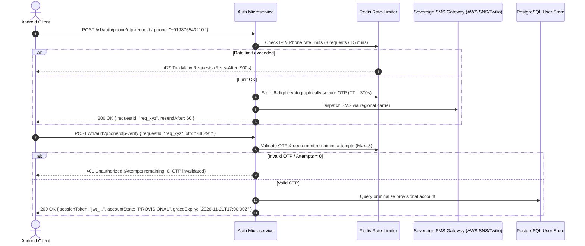

# Functional Requirements Specification (FRS): Oi

> **Document ID:** FRS-002-CORE  
> **Status:** Confirmed Baseline  
> **Last Updated:** 2026-11-07  
> **Project Repository:** `https://github.com/shanuthchimbli/oisocialapp`  
> **Author:** Lead Systems Architect & Product Analyst  
> **Traceability Upstream:** [`docs/01_PRODUCT_REQUIREMENTS.md`](file:///Users/shanuthchimbli/.gemini/antigravity/scratch/oisocialapp/docs/01_PRODUCT_REQUIREMENTS.md)  

---

## 1. Purpose & Scope

This Functional Requirements Specification defines the precise system behavior, input validation rules, state transitions, business logic, and error handling for the **Oi** messaging platform. Every requirement in this specification is deterministically verifiable via automated functional tests.

### Functional Scope
1. **Phone Authentication & Session Lifecycle**
2. **Government Identity Verification & Account Onboarding**
3. **Unique Username System & Handle Governance**
4. **Text-Only Status Updates**
5. **One-to-One Private Text Messaging**
6. **User Relations: Blocking, Reporting & Privacy**
7. **Single Active Device Enforcement & Account Recovery**
8. **365-Day Retention Deletion Engine**

---

## 2. Phone Authentication & Onboarding Specifications

### Requirement Statements: Phone Auth & OTP

| Requirement ID | Specification Statement | Parent PRD | Acceptance Criteria |
| :--- | :--- | :---: | :--- |
| `FUNC-AUTH-001` | The system must validate phone numbers against Google's `libphonenumber` standard in strict E.164 format. Initial launch supports `+91` (India), `+44` (UK), and `+1` (USA). Invalid formats must be rejected with `ERR_INVALID_PHONE_FORMAT`. | `PRD-002` | Unit tests verify valid and malformed numbers across all three jurisdictions. |
| `FUNC-AUTH-002` | SMS OTP codes must consist of exactly 6 cryptographically random digits ($[0-9]^6$) generated using a CSPRNG (`SecureRandom` / `crypto/rand`). Pseudo-random generation is banned. | `PRD-002` | Statistical randomness analysis across 10,000 generated tokens passes NIST SP 800-22 test suites. |
| `FUNC-AUTH-003` | An OTP token must expire exactly 300 seconds (5 minutes) after creation. Expired tokens must be immediately purged from memory. | `PRD-002` | Submitting verification at $t=301\text{ s}$ fails with `ERR_OTP_EXPIRED`. |
| `FUNC-AUTH-004` | A maximum of 3 incorrect OTP submission attempts is permitted per session. Upon the 3rd failed attempt, the OTP is invalidated, and the session is locked for 15 minutes. | `PRD-002` | The 4th attempt is rejected with `ERR_MAX_ATTEMPTS_EXCEEDED` regardless of payload. |
| `FUNC-AUTH-005` | SMS dispatch must enforce a mandatory 60-second cooldown period before a resend can be requested. | `PRD-002` | Resend requests at $t < 60\text{ s}$ return HTTP 429 with remaining seconds. |
| `FUNC-AUTH-006` | Global SMS rate limits: Maximum 3 OTP dispatches per phone number per hour; maximum 10 OTP requests per source IP per hour. | `PRD-002` | Abuse simulations exceeding thresholds receive `ERR_RATE_LIMIT_EXCEEDED`. |

---

## 3. Government Identity Verification Specifications

| Requirement ID | Specification Statement | Parent PRD | Acceptance Criteria |
| :--- | :--- | :---: | :--- |
| `FUNC-ID-001` | Accounts validated via phone OTP enter `PROVISIONAL` state. The user has exactly 14 calendar days (336 hours) from initial OTP validation to complete sovereign verification. | `PRD-001`, `PRD-003` | Timestamp comparisons trigger automated state transition to `SUSPENDED` at $t=336\text{ h} + 1\text{ s}$. |
| `FUNC-ID-002` | **India (+91):** The system must accept UIDAI Offline Paperless e-KYC (XML). The client uploads the resident-downloaded, share-code-encrypted XML. The server decrypts with the resident's 4-digit code, verifies UIDAI's RSA-2048 public key digital signature, and validates timestamp freshness ($\le 72\text{ hours}$). | `PRD-003` | Tampered XML or invalid signatures fail with `ERR_UIDAI_SIGNATURE_INVALID`. |
| `FUNC-ID-003` | **UK (+44):** The system must authenticate identity claims via DIATF-certified identity gateway asserting GDS IAL2 compliance. Raw passport numbers or biometric streams are discarded after signature verification. | `PRD-003` | Successful assertion transitions account to `VERIFIED`. |
| `FUNC-ID-004` | **USA (+1):** The system must authenticate identity via ISO/IEC 18013-5 compliant Mobile Driver's License (mDL) digital signature or AAMVA DLDV gateway assertions. | `PRD-003` | Cryptographically signed mDL response validated against state issuing authority root certificates. |
| `FUNC-ID-005` | **One-Person-One-Account Deduplication:** Upon successful validation, the system computes: $\text{Nullifier} = \text{HMAC-SHA256}(\text{MasterPepper}, \text{CountryCode} \parallel \text{DocType} \parallel \text{StandardizedIDNumber})$. The raw ID is immediately zeroized in RAM. If the computed nullifier matches an existing record in the database, registration fails with `ERR_IDENTITY_DUPLICATE`. | `PRD-001` | Second registration attempt using the same document triggers instant duplicate rejection without leaking prior account details. |
| `FUNC-ID-006` | **Provisional Quota:** Users in `PROVISIONAL` state may initiate outbound chat sessions with at most 3 distinct contacts. Attempting to initiate a 4th conversation returns `ERR_PROVISIONAL_LIMIT_REACHED`. Inbound messages are unrestricted. | `PRD-001` | Automated test proves 4th cold outbound message is rejected at API gateway. |
| `FUNC-ID-007` | **Suspension & 5-Day Cooldown:** If verification is not completed within 14 days, the account transitions to `SUSPENDED`. If unresolved after 30 days of suspension, the account is deleted. Following deletion of an unverified account, the phone number is barred from re-registering for 5 calendar days. | `PRD-001` | Registration attempted on day 4 post-deletion fails with `ERR_REGISTRATION_COOLDOWN_ACTIVE`. |

---

## 4. Unique Username System Specifications

| Requirement ID | Specification Statement | Parent PRD | Acceptance Criteria |
| :--- | :--- | :---: | :--- |
| `FUNC-USR-001` | Every account must possess a unique username between 3 and 30 characters matching the regex `^[a-z0-9][a-z0-9_]{1,28}[a-z0-9]$`. Leading, trailing, or double underscores (`__`) are strictly rejected. | `PRD-004` | Schema regex check rejects `_user`, `user_`, `us__er`, and handles with special chars. |
| `FUNC-USR-002` | Global uniqueness must be enforced case-insensitively via a PostgreSQL `citext` column with a `UNIQUE` index. | `PRD-004` | Attempting to register `JohnDoe` when `johndoe` exists returns `ERR_USERNAME_TAKEN`. |
| `FUNC-USR-003` | Usernames are decoupled from the permanent account ID (`UUIDv7`). Changing a username does not mutate the account ID or invalidate active E2EE ratchets. | `PRD-004` | Existing chats maintain cryptographic session continuity after a username update. |
| `FUNC-USR-004` | A user can change their username at most once every 30 calendar days. Attempts prior to cooldown expiry are rejected with `ERR_USERNAME_CHANGE_COOLDOWN`. | `PRD-004` | Update attempt at day 29 fails with HTTP 429. |
| `FUNC-USR-005` | System Reserved Blacklist: The system maintains an immutable blacklist of reserved words (`admin`, `support`, `oi`, `official`, `system`, `police`, `help`). Registrations matching these are rejected with `ERR_USERNAME_RESERVED`. | `PRD-004` | Fuzz test confirms all 250 reserved terms cannot be claimed. |
| `FUNC-USR-006` | Abandoned Username Quarantine: When a username is changed, the abandoned handle enters a 180-day quarantine. During this period, only the original account can reclaim it. After 180 days, it is unlocked for general registration. | `PRD-004` | Third-party claim during day 179 fails with `ERR_USERNAME_QUARANTINED`; succeeds on day 181. |

---

## 5. Text-Only Status Specifications

| Requirement ID | Specification Statement | Parent PRD | Acceptance Criteria |
| :--- | :--- | :---: | :--- |
| `FUNC-STAT-001` | A user can publish a text status update containing between 1 and 140 UTF-8 characters. Whitespace-only updates are rejected. | `PRD-008` | Payloads with 0 chars or $>140$ chars fail validation with `ERR_INVALID_STATUS_LENGTH`. |
| `FUNC-STAT-002` | Status updates persist indefinitely in the database until explicitly updated or manually deleted by the author. There is no automatic 24-hour expiration. | `PRD-008` | Automated time-shift test verifies status persists at $t = 24\text{ hours} + 1\text{ second}$. |
| `FUNC-STAT-003` | Status Privacy Settings: Authors can configure status visibility to: (a) *My Contacts* (mutual contact list), or (b) *Nobody* (disabled). Blocked users are strictly excluded regardless of setting. | `PRD-008` | Blocked users querying `/v1/status/:userId` receive HTTP 404. |
| `FUNC-STAT-004` | Deleting a status completely erases the record from the central Redis cache and PostgreSQL database. Subsequent queries return `status: null`. | `PRD-008` | Direct database assertion proves physical record deletion. |
| `FUNC-STAT-005` | Strict Media Rejection: Status submission endpoints accept only `text/plain` or JSON `{ "statusText": "..." }`. Any multipart form, binary attachment, HTML tag, or Markdown link parsing is rejected. | `PRD-008`, `PRD-010` | Payloads containing `<script>`, `[link](url)`, or raw binary fail validation. |

---

## 6. One-to-One Private Text Messaging Specifications

| Requirement ID | Specification Statement | Parent PRD | Acceptance Criteria |
| :--- | :--- | :---: | :--- |
| `FUNC-MSG-001` | Messaging is strictly restricted to one-to-one (1:1) private text. Group chats, broadcast lists, and multi-party channels are architecturally barred. | `PRD-009`, `PRD-010` | The messaging API rejects payloads with more than one recipient UUID. |
| `FUNC-MSG-002` | Maximum message length is 4,096 UTF-8 characters. Messages exceeding this limit are rejected with `ERR_MESSAGE_TOO_LONG`. | `PRD-009` | Payload of 4,097 chars is rejected at the client ViewModel and API gateway. |
| `FUNC-MSG-003` | Message Delivery States: Every message must progress deterministically through four visible states: (1) `SENDING` (local clock), (2) `SENT` (server ACK received), (3) `DELIVERED` (recipient device ACK received), and (4) `READ` (recipient opened chat). | `PRD-009` | State machine tests verify strict monotonic transitions ($1 \to 2 \to 3 \to 4$). |
| `FUNC-MSG-004` | Offline Message Queue: Messages created while offline are queued in local encrypted Room database with state `SENDING`. Upon network reconnection, the client automatically flushes the queue over the WebSocket connection in FIFO order. | `PRD-009` | Airplane mode test verifies automatic sync and transmission upon reconnect. |
| `FUNC-MSG-005` | Message Deduplication: Every message carries a client-generated UUIDv7 and ratchet sequence number. The server and recipient database maintain unique constraints to discard duplicate submissions without error. | `PRD-009` | Resending identical message frame 5 times results in exactly 1 persisted message. |
| `FUNC-MSG-006` | Message Ordering: Messages within a 1:1 conversation are ordered by the server-assigned monotonic sequence ID combined with client timestamp. UI renders messages in strict chronological order. | `PRD-009` | Out-of-order delivery over erratic network is rendered in correct conversational order. |
| `FUNC-MSG-007` | Client-Side Full-Text Search: Users can search their local conversation history using SQLite FTS5. The search runs 100% locally on the device; search queries are never transmitted to any server. | `PRD-009` | Search queries return accurate results in offline airplane mode. |

---

## 7. Single Active Device & Account Recovery Specifications

| Requirement ID | Specification Statement | Parent PRD | Acceptance Criteria |
| :--- | :--- | :---: | :--- |
| `FUNC-DEV-001` | Single Active Device Enforcement: When an account authenticates on Device B, the server immediately revokes Device A's session JWT and refresh token in Redis. | `PRD-005` | Device A's subsequent API calls return HTTP 401 `ERR_SESSION_TERMINATED`. |
| `FUNC-DEV-002` | High-Priority Session Revocation Push: Concurrently with session invalidation, the server dispatches a high-priority silent FCM push to Device A. Upon receipt, Device A immediately zeroes active cryptographic session keys in memory and displays a modal: *"Your Oi account has been activated on another device."* | `PRD-005` | Android integration test verifies instant UI lockout and keystore zeroization. |
| `FUNC-DEV-003` | Account Recovery via Government Re-Verification: If a user loses their phone number, they initiate recovery from a new number. The workflow requires: (1) SMS OTP on new number, (2) Re-submitting sovereign identity verification matching the original nullifier, (3) Confirming ownership. Once verified, the permanent UUIDv7 is mapped to the new number, and all prior sessions are revoked. | `PRD-011` | Automated test proves account ownership and username are preserved under the new phone number. |
| `FUNC-DEV-004` | Zero Employee Override Invariant: Administrative and support consoles have zero programmatic capability to bypass OTP, override government verification, or transfer account ownership. | `PRD-011` | Audit confirms no administrative endpoints or database procedures exist for manual overrides. |

---

## 8. User Relations: Blocking & Abuse Reporting

| Requirement ID | Specification Statement | Parent PRD | Acceptance Criteria |
| :--- | :--- | :---: | :--- |
| `FUNC-REL-001` | Blocking: A user can block any registered account. Once blocked: (a) Blocker receives zero messages or notifications from blocked user; (b) Blocked user sees single ticks (`SENT`) only; (c) Blocked user cannot view blocker's status update or online presence. | `PRD-008`, `PRD-009` | Verification tests prove complete bidirectional isolation. |
| `FUNC-REL-002` | Abuse Reporting: A user can submit an abuse report against a contact. The report payload contains: (a) Reported user UUIDv7, (b) Reason category, (c) Reporter's digital signature. Conversation plaintext is never automatically uploaded to the server to preserve E2EE integrity. | `PRD-009` | Security audit proves zero conversation plaintext is received by abuse intake endpoints. |

---

## 9. 365-Day Data Retention Deletion Engine

| Requirement ID | Specification Statement | Parent PRD | Acceptance Criteria |
| :--- | :--- | :---: | :--- |
| `FUNC-RET-001` | Server-Side Transit Purge: Messages in transit on server relays (queued for offline users) must be deleted from memory and disk immediately upon delivery confirmation, or purged after 30 days if undelivered. | `PRD-007` | Undelivered messages older than 30 days are permanently purged by cron sweep. |
| `FUNC-RET-002` | Client-Side 365-Day Retention Engine: The Android client runs an automated Android WorkManager background task every 24 hours that executes: `DELETE FROM messages WHERE timestamp < (NOW() - 365 DAYS);` followed by SQLite `VACUUM;`. | `PRD-007` | Automated test with mocked system clock proves messages $\ge 365\text{ days} + 1\text{ second}$ are erased. |
| `FUNC-RET-003` | Query Layer Barrier: Even prior to daily vacuum, the client Room DAO and server API enforce a strict query barrier: `WHERE created_at >= (NOW() - INTERVAL '365 days')`. Expired messages are mathematically inaccessible to queries. | `PRD-007` | API and local DAO queries return zero results for messages beyond the 365-day threshold. |
