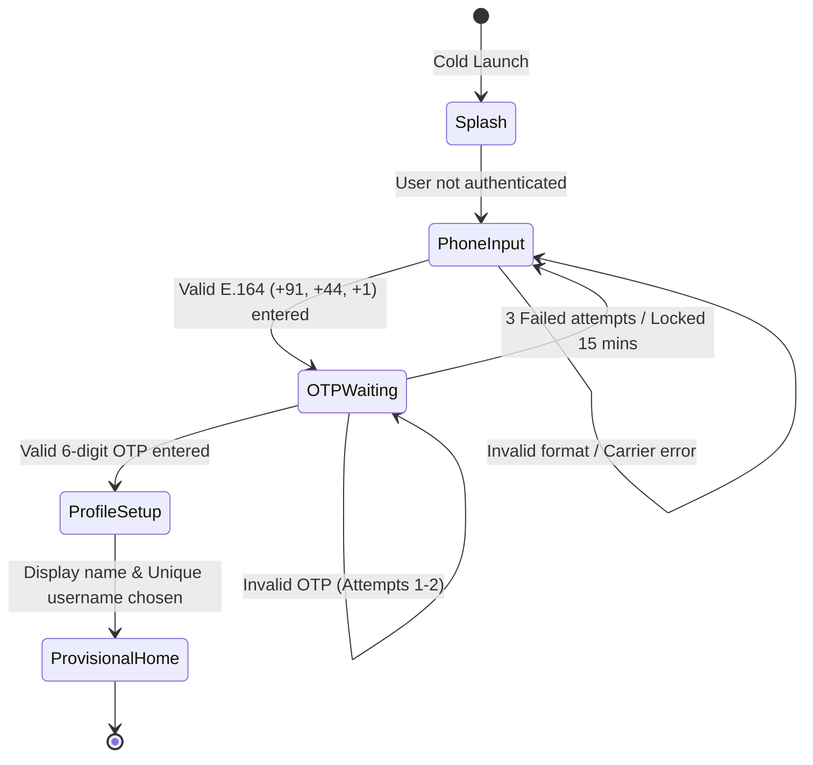
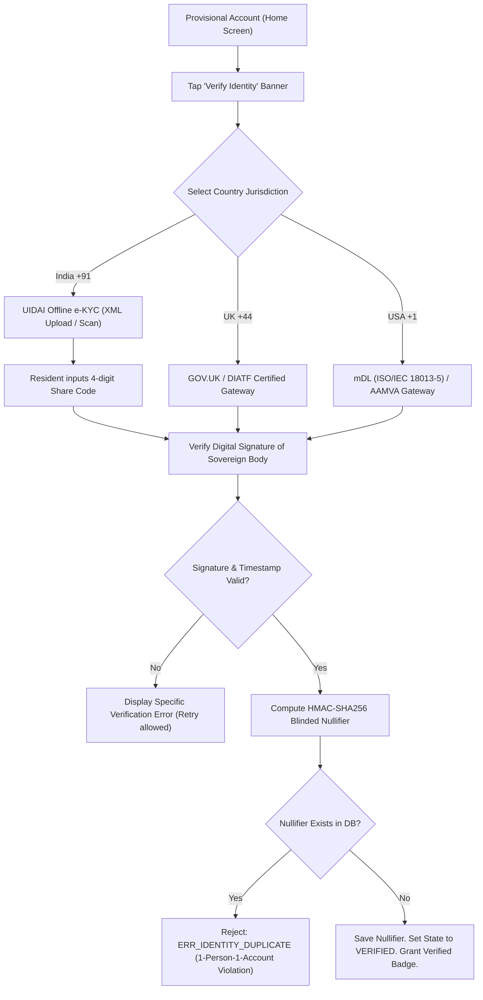
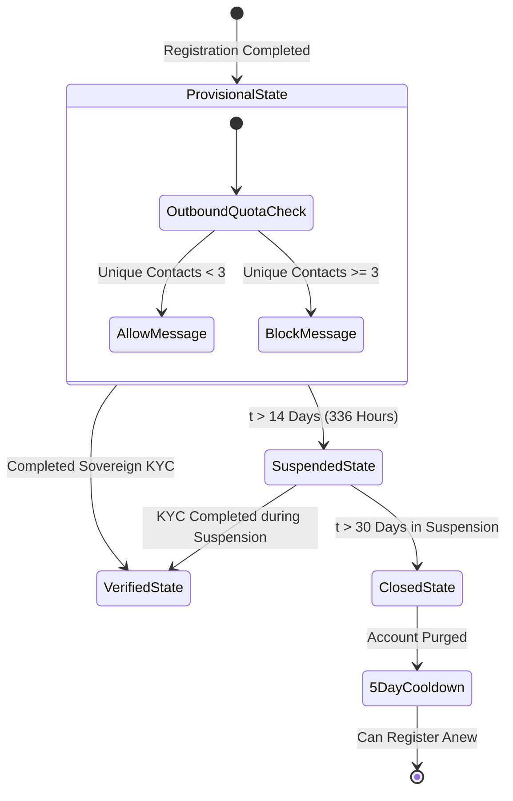
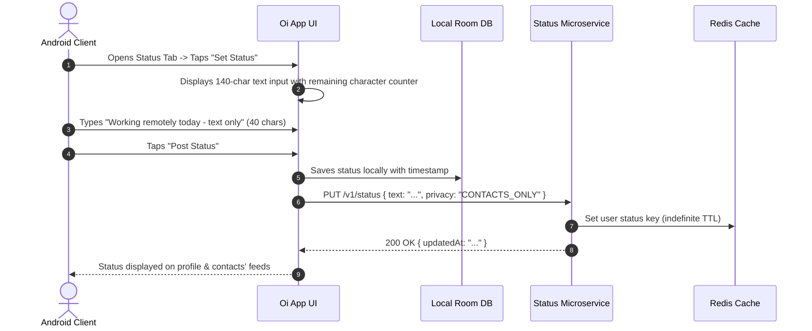
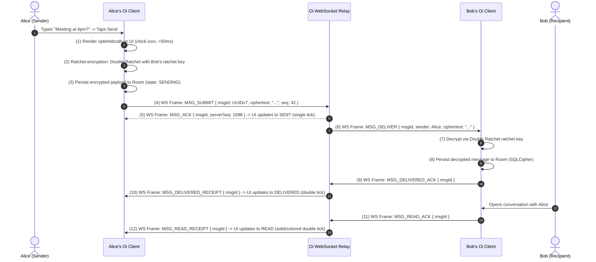
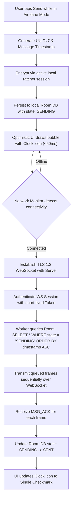
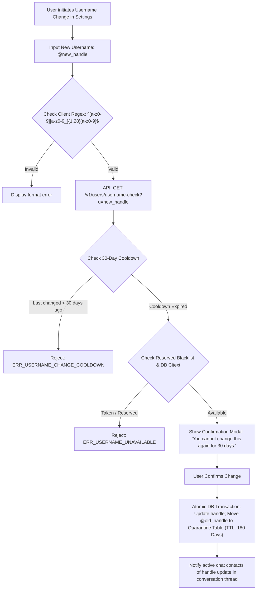
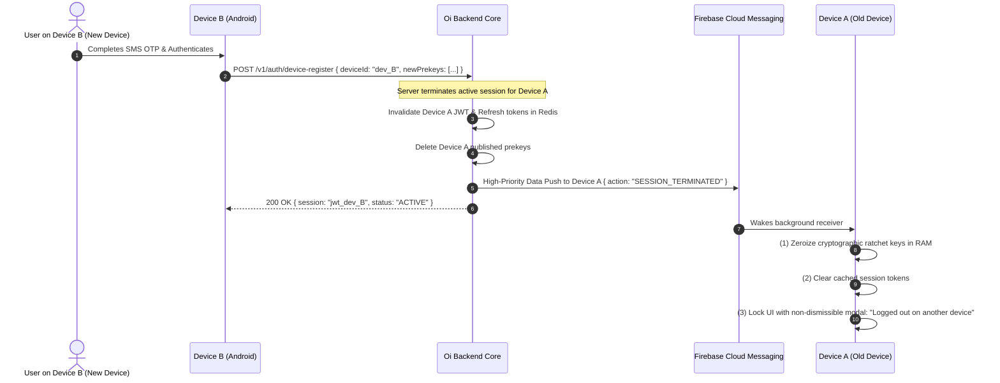
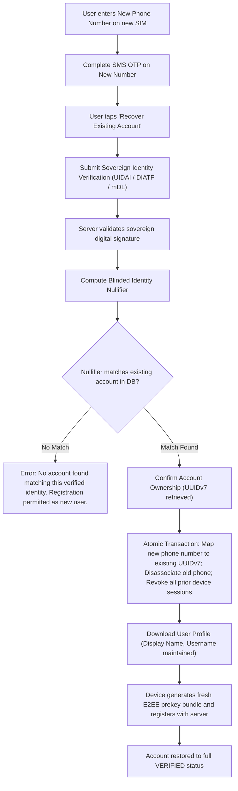

# User Flows & State Transition Specifications: Oi

> **Document ID:** FLOW-003-CORE  
> **Status:** Confirmed Baseline  
> **Last Updated:** 2026-11-07  
> **Project Repository:** `https://github.com/shanuthchimbli/oisocialapp`  
> **Author:** Mobile UX Architect & Lead Systems Engineer  
> **Traceability Upstream:** [`docs/01_PRODUCT_REQUIREMENTS.md`](file:///Users/shanuthchimbli/.gemini/antigravity/scratch/oisocialapp/docs/01_PRODUCT_REQUIREMENTS.md), [`docs/02_FUNCTIONAL_REQUIREMENTS.md`](file:///Users/shanuthchimbli/.gemini/antigravity/scratch/oisocialapp/docs/02_FUNCTIONAL_REQUIREMENTS.md)  

---

## 1. Executive Summary & Flow Index

This document maps all user journeys, state transitions, interactive edge cases, and failure recoveries for **Oi**. Each flow defines:
1. **Entry Criteria & Preconditions**
2. **Step-by-Step Interactions & UI State Transitions**
3. **Happy Path Sequence**
4. **Error & Edge-Case Branches**
5. **Post-Conditions & Cryptographic Side-Effects**

### Master Flow Directory
- **Flow 1:** New User Registration & SMS Phone Authentication
- **Flow 2:** Sovereign Identity Verification (India, UK, USA)
- **Flow 3:** 14-Day Grace Window & Provisional Account Constraints
- **Flow 4:** Text-Only Status Management (Publish, Update, Delete)
- **Flow 5:** Real-Time 1:1 End-to-End Encrypted Chat
- **Flow 6:** Offline Message Queuing & Reconnection Synchronization
- **Flow 7:** Controlled Username Modification & Quarantine
- **Flow 8:** Single Device Login & Remote Device Invalidation
- **Flow 9:** Lost Phone Number & Account Recovery via Re-Verification
- **Flow 10:** User Blocking & Abuse Reporting
- **Flow 11:** 365-Day Message Lifecycle Purge
- **Flow 12:** Permanent Account Deletion & Cryptographic Teardown

---

## 2. Flow 1: New User Registration & Phone Verification



### Flow 1 Specification

| Phase | User Action / Trigger | System Response & UI State | Backend / Cryptographic Action |
| :--- | :--- | :--- | :--- |
| **1.1 Input** | User enters mobile number with country prefix (`+91`, `+44`, `+1`). Taps *Continue*. | Validates E.164 pattern. Disables button; shows loading spinner. | `POST /v1/auth/phone/otp-request`. Redis checks IP and phone rate limits. Generates 6-digit CSPRNG OTP. Dispatches SMS via regional carrier. |
| **1.2 Verify**| User inputs 6-digit OTP received via SMS. | Auto-advances focus on digit input; submits automatically on 6th digit. | `POST /v1/auth/phone/otp-verify`. Validates OTP against Redis hash. Generates initial session JWT. |
| **1.3 Profile**| User enters Display Name (1–50 chars) and desired Username (3–30 chars). | Real-time debounced username availability check ($\le 200\text{ ms}$). Shows green checkmark if available. | `GET /v1/users/username-check?u=handle`. Verifies against PostgreSQL `citext` index and reserved blacklist. |
| **1.4 Keys** | User taps *Complete Registration*. | Client generates cryptographic identity keys in hardware Keystore. | Generates Curve25519 Identity Key ($IK$), Signed Prekey ($SPK$), and 100 One-Time Prekeys ($OPK$). Uploads public prekey bundle to server. Account state set to `PROVISIONAL`. |

---

## 3. Flow 2: Sovereign Identity Verification



### Flow 2 Error Handling & Edge Cases
- **Tampered XML Package:** Server verifies UIDAI's RSA-2048 public certificate. If any byte is altered, verification fails immediately with `ERR_SIGNATURE_VERIFICATION_FAILED`.
- **Stale XML (>72 hours old):** Rejected with `ERR_DOCUMENT_EXPIRED`. User is prompted to download a fresh XML from `myaadhaar.uidai.gov.in`.
- **Duplicate Human Identity:** If the computed nullifier matches an existing account, the user is notified: *"This government identity is already registered to an existing Oi account. If you lost access to your prior account, please initiate Account Recovery."*

---

## 4. Flow 3: 14-Day Grace Window & Provisional Account Constraints



### Flow 3 Rules
1. **Outbound Messaging Cap:** A provisional user can initiate conversations with a maximum of **3 unique contacts**. Once a recipient replies, conversation is unlocked. Cold outbound outreach to a 4th contact triggers an in-app prompt: *"Complete Identity Verification to message more people."*
2. **Countdown Banner:** A persistent top-bar banner displays: *"Verified Identity required in X days. Tap to verify."*
3. **Suspension Lockdown:** At $t = 336\text{ hours}$, background cron transitions state to `SUSPENDED`. WebSocket connection drops; all message inputs are locked. Only the *Verify Identity* screen remains accessible.

---

## 5. Flow 4: Text-Only Status Management



### Status Deletion Flow
- User taps *Clear Status*.
- App requests confirmation modal: *"Remove your current status?"*
- Upon confirmation: `DELETE /v1/status`.
- Redis erases the key; local Room DB clears the record. Status vanishes from all contacts' screens upon their next sync.

---

## 6. Flow 5: Real-Time 1:1 End-to-End Encrypted Chat



---

## 7. Flow 6: Offline Message Queuing & Reconnection



---

## 8. Flow 7: Controlled Username Modification & Quarantine



---

## 9. Flow 8: Single Device Login & Remote Invalidation



---

## 10. Flow 9: Account Recovery (Lost Phone Number)



---

## 11. Flow 10: User Blocking & Abuse Reporting

### 11.1 Blocking Flow
1. User Alice opens conversation settings with Bob $\to$ Taps *Block User*.
2. Modal confirmation: *"Block @bob? They cannot message you or see your status."*
3. Alice confirms $\to$ Local Room DB inserts record into `blocked_users` table; API called `POST /v1/users/block { targetUserId: "uuid_bob" }`.
4. Subsequent messages from Bob are dropped silently by server router. Bob's UI remains at single tick (`SENT`) with zero delivery receipt.

### 11.2 Abuse Reporting Flow
1. User Alice taps *Report Contact* $\to$ Selects reason (Spam, Harassment, Impersonation).
2. Client app prompts: *"Submit abuse report? The server will review reported user handle and metadata."*
3. Client creates cryptographic report package: `{ reporter: AliceUUID, reported: BobUUID, reason: "HARASSMENT", timestamp: now }` signed by Alice's identity key.
4. Plaintext message contents are **never** transmitted to ensure strict zero-knowledge E2EE guarantees.

---

## 12. Flow 11: 365-Day Message Lifecycle Purge

```mermaid
sequenceDiagram
    autonumber
    participant Worker as Android WorkManager (Daily 03:00)
    participant Room as Local Encrypted Room DB
    participant Server as Server Cleanup Cron (Daily 03:00 UTC)
    participant Pg as PostgreSQL Message Relay Store

    Note over Worker,Room: Client-Side Local Purge
    Worker->>Room: SELECT COUNT(*) FROM messages WHERE created_at < (NOW() - 365 Days)
    Room-->>Worker: Found N expired records
    Worker->>Room: DELETE FROM messages WHERE created_at < (NOW() - 365 Days)
    Worker->>Room: VACUUM; (Reclaim disk pages & zeroize storage)
    
    Note over Server,Pg: Server-Side Transit Purge
    Server->>Pg: DELETE FROM transit_messages WHERE delivered = TRUE OR created_at < (NOW() - 30 Days)
    Server->>Pg: VACUUM ANALYZE transit_messages;
```

---

## 13. Flow 12: Permanent Account Deletion

1. User opens Settings $\to$ *Account* $\to$ *Delete Account*.
2. Security Warning: *"This action is permanent. All active sessions, chats, and handles will be deleted. Messages on your device will be purged immediately."*
3. Re-authentication: User confirms with biometric/PIN prompt and SMS OTP.
4. Server action:
   - Purges user profile, active prekeys, and session tokens.
   - Moves Blinded Identity Nullifier to `deleted_identity_tombstones` with a 90-day anti-abuse cooling period.
   - Releases username to quarantine.
5. Client action:
   - Executes Android Keystore `keyStore.deleteEntry(alias)` for all identity and ratchet keys.
   - Deletes encrypted Room database files and shared preferences.
   - Resets app back to initial Splash/Registration screen.
