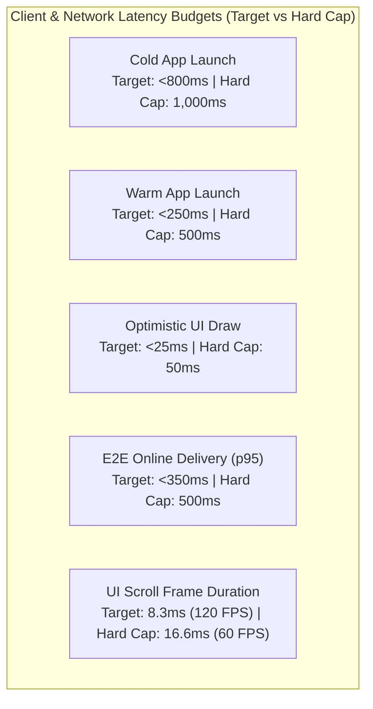
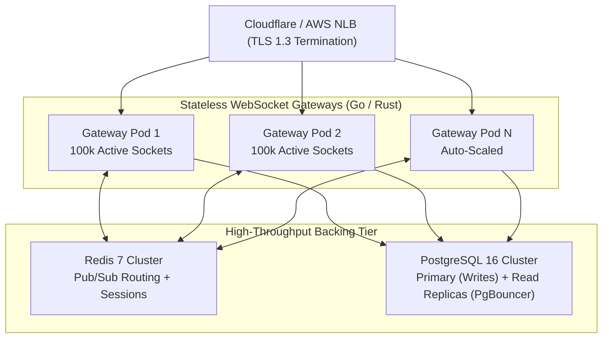

# Non-Functional Requirements & Performance SLOs: Oi

> **Document ID:** NFR-004-CORE  
> **Status:** Confirmed Baseline  
> **Last Updated:** 2026-11-07  
> **Project Repository:** `https://github.com/shanuthchimbli/oisocialapp`  
> **Author:** Performance Architect & Lead Infrastructure Engineer  
> **Traceability Upstream:** [`docs/01_PRODUCT_REQUIREMENTS.md`](file:///Users/shanuthchimbli/.gemini/antigravity/scratch/oisocialapp/docs/01_PRODUCT_REQUIREMENTS.md)  

---

## 1. Executive Summary & Quality Attributes

This specification sets rigorous, measurable Non-Functional Requirements (NFRs) and Service Level Objectives (SLOs) for **Oi**. As a minimalist, verified-identity messaging application, performance, security, and battery efficiency are primary engineering differentiators, not secondary optimizations.

---

## 2. Performance Engineering & Latency Budgets

### 2.1 Latency SLO Specifications

| Requirement ID | Attribute / Interaction | Measurement Metric | Target (p50) | Target (p95) | Hard Cap (p99) | Verification Method |
| :--- | :--- | :---: | :---: | :---: | :---: | :--- |
| `PERF-001` | Cold App Launch | Wall-clock time from icon tap to fully interactive chat list | $< 600\text{ ms}$ | $< 800\text{ ms}$ | $\le 1{,}000\text{ ms}$ | Android Macrobenchmark on Pixel 4a (Low-tier Baseline) |
| `PERF-002` | Warm App Launch | Time from task switch to foreground interactive | $< 150\text{ ms}$ | $< 250\text{ ms}$ | $\le 500\text{ ms}$ | Android Macrobenchmark |
| `PERF-003` | Cached Chat List Render | Time to query encrypted Room and draw Compose items | $< 40\text{ ms}$ | $< 70\text{ ms}$ | $\le 100\text{ ms}$ | Jetpack Compose Microbenchmark |
| `PERF-004` | Conversation Screen Open | Time to load recent 50 messages from Room and render | $< 40\text{ ms}$ | $< 75\text{ ms}$ | $\le 100\text{ ms}$ | Automated UI Benchmark |
| `PERF-005` | Optimistic Message Draw | Time from user tapping "Send" to message drawn with clock | $< 15\text{ ms}$ | $< 30\text{ ms}$ | $\le 50\text{ ms}$ | Choreographer frame render timing |
| `PERF-006` | Online E2E Message Delivery | Time from Sender WS transmit to Recipient WS receive (Good 4G/5G) | $< 200\text{ ms}$ | $< 350\text{ ms}$ | $\le 500\text{ ms}$ | Distributed OpenTelemetry trace metrics |
| `PERF-007` | UI Frame Scroll Rate | Compose message list flinging frame rendering time | $\le 8.3\text{ ms}$ (120 FPS) | $\le 16.6\text{ ms}$ (60 FPS) | $0\text{ jank frames}$ | Android FrameMetrics API |
| `PERF-008` | Local SQLite Encrypted Write | Time to insert single encrypted message into Room | $< 4\text{ ms}$ | $< 8\text{ ms}$ | $\le 15\text{ ms}$ | Room SQLite microbenchmark |

---

## 3. Hardware Resource Utilization & Efficiency

### 3.1 Memory Footprint (RAM)
- `NFR-MEM-001`: In an active conversation containing 1,000 locally cached messages, the Android application Resident Set Size (RSS) must not exceed **50 MB** on devices with 2 GB RAM.
- `NFR-MEM-002`: The app must exhibit zero memory leaks. All Kotlin Coroutine scopes, ViewModel observers, and Compose DisposableEffects must be cleanly reclaimed during screen transitions (verified via LeakCanary in CI).

### 3.2 Battery Consumption
- `NFR-BAT-001`: In standby/background mode over a 24-hour period (connected to Wi-Fi/4G with occasional FCM data pings), the app must consume less than **1.5% of total battery capacity** on standard 4,000 mAh devices.
- `NFR-BAT-002`: The app must not hold persistent wake locks. Network operations must be dispatched via Android `WorkManager` or JobScheduler adhering to Android Doze Mode constraints.

### 3.3 Binary Size & Over-the-Air Footprint
- `NFR-BIN-001`: The production Android App Bundle (AAB) download size must not exceed **15 MB**.
- `NFR-BIN-002`: Eliminating multimedia libraries (no ExoPlayer, no WebRTC C++ binaries, no image decoding engines like Glide or Coil) keeps the native DEX code minimal and startup blazing fast.

---

## 4. Network Resilience & Extreme Conditions

| Requirement ID | Network Condition | System Invariant & Behavior |
| :--- | :--- | :--- |
| `NFR-NET-001` | **Weak / Edge Signals (2G / High Latency)** | WebSocket connection must dynamically throttle heartbeat ping/pong to conserve bandwidth. Payload frames must stay under 2 KB, preventing TCP segment fragmentation. |
| `NFR-NET-002` | **Sudden Disconnection (Subway / Tunnel)** | Outbound messages are transparently queued in local Room DB with state `SENDING`. Zero message loss occurs. UI clearly indicates pending status without blocking input. |
| `NFR-NET-003` | **Cellular $\leftrightarrow$ Wi-Fi Handover** | When IP address switches during active connection, the client transparently re-establishes TLS 1.3 session within 500 ms using session tickets, flushing pending ACKs without duplicate messages. |
| `NFR-NET-004` | **Exponential Reconnect Backoff** | In prolonged offline states, the reconnect worker backs off exponentially: $1\text{ s}, 2\text{ s}, 4\text{ s}, 8\text{ s}, 16\text{ s}, \dots, \text{capped at } 60\text{ s}$ with random $\pm 20\%$ jitter to prevent thundering herd on server gateways. |

---

## 5. Backend Scalability, Availability & Concurrency

### Scalability Specifications
- `NFR-SCALE-001`: Each stateless WebSocket gateway node (4 vCPU, 8 GB RAM) must sustain at least **100,000 concurrent connected idle sockets** with $< 200\text{ MB}$ memory consumption using non-blocking event loops (epoll/kqueue).
- `NFR-SCALE-002`: Backend message routing latency via Redis Pub/Sub must not exceed **5 ms p99** across nodes.
- `NFR-SCALE-003`: The primary relational database (PostgreSQL 16) must handle up to **10,000 write queries per second (QPS)** using transaction connection pooling via PgBouncer.

### Availability & Reliability SLOs
- `NFR-AVAIL-001`: Central messaging relay service availability must achieve **99.95% uptime** measured on a monthly rolling window (excluding pre-announced maintenance windows).
- `NFR-RECOVER-001`: In the event of a catastrophic host failure, stateless Kubernetes gateway pods must reschedule and recover healthy state within **15 seconds** (RTO $\le 15\text{ s}$).
- `NFR-BACKUP-001`: Point-in-time recovery (PITR) for PostgreSQL must guarantee a Recovery Point Objective (RPO) of $\le 5\text{ minutes}$.

---

## 6. Maintainability & Single-Developer Operational Feasibility

- `NFR-OPS-001`: The entire backend infrastructure must be defined 100% as code (IaC) via **Terraform** or **OpenTofu**. Manual server configuration via cloud web consoles is strictly prohibited.
- `NFR-OPS-002`: Containerized microservices must possess self-healing health check probes (`/healthz` and `/readyz`). Unhealthy instances must be automatically terminated and replaced by orchestrators without human intervention.
- `NFR-OPS-003`: Automated CI/CD pipelines must execute full static analysis, unit test suites, and integration tests within **10 minutes** of pull request submission.

---

## 7. Security, Observability & Compliance

- `NFR-SEC-001`: **Zero-Knowledge Telemetry:** Application logs, crash reports, and server traces must **never** record message ciphertext, message plaintext, phone numbers, or government document numbers. All logs use anonymized UUIDv7 tokens only.
- `NFR-SEC-002`: All transport communication is strictly pinned to **TLS 1.3** with modern cipher suites (`TLS_AES_256_GCM_SHA384`, `TLS_CHACHA20_POLY1305_SHA256`). Deprecated protocols (TLS 1.0, 1.1, 1.2) are rejected at the edge.
- `NFR-OBS-001`: Distributed tracing using **OpenTelemetry** must trace every message relay hop with unique Trace IDs without exposing confidential user payload attributes.
