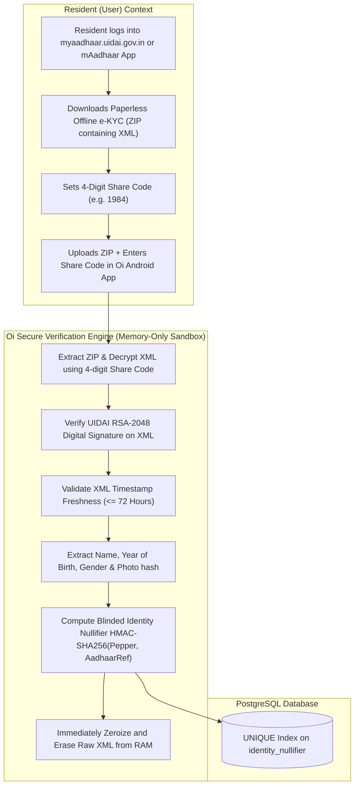
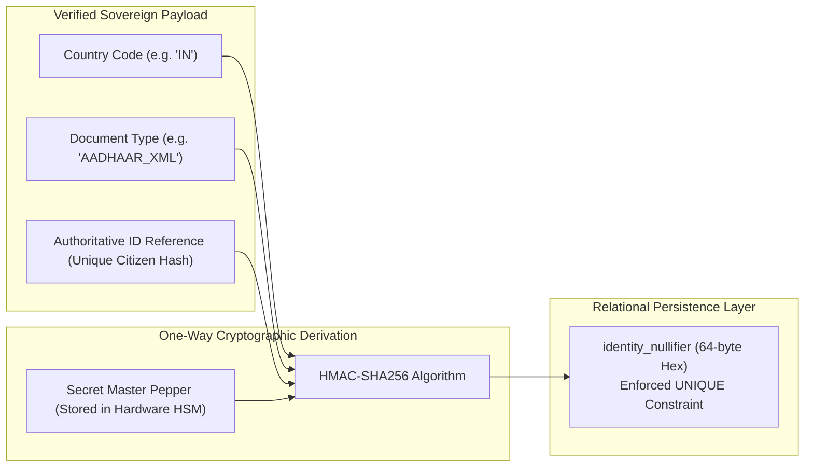

# Sovereign Identity & Verification Systems Specification: Oi

> **Document ID:** ID-005-GOV  
> **Status:** Requires Statutory & Technical Verification  
> **Last Updated:** 2026-11-07  
> **Project Repository:** `https://github.com/shanuthchimbli/oisocialapp`  
> **Author:** Legal Compliance Engineer & Security Architect  
> **Traceability Upstream:** [`docs/01_PRODUCT_REQUIREMENTS.md`](file:///Users/shanuthchimbli/.gemini/antigravity/scratch/oisocialapp/docs/01_PRODUCT_REQUIREMENTS.md), [`docs/02_FUNCTIONAL_REQUIREMENTS.md`](file:///Users/shanuthchimbli/.gemini/antigravity/scratch/oisocialapp/docs/02_FUNCTIONAL_REQUIREMENTS.md)  

---

## 1. Executive Summary & Policy Invariant

**Oi** strictly mandates that identity verification must be conducted **exclusively through sovereign, government-operated, or statutory legally authorized identity systems**. Generic commercial identity aggregators, unvetted credit bureaus, and proprietary biometric data brokers are strictly prohibited from the architecture.

This document establishes the verified integration pathways, statutory constraints, data minimization standards, and cryptographic deduplication mechanisms for the initial launch jurisdictions:
- **India (`+91`):** UIDAI Aadhaar Offline Paperless e-KYC (XML / Secure QR)
- **United Kingdom (`+44`):** GOV.UK One Login & DIATF Trust Framework Gateways
- **United States (`+1`):** State Mobile Driver's License (mDL - ISO/IEC 18013-5) & AAMVA DLDV

---

## 2. India (+91): Statutory UIDAI / Aadhaar Architecture

### 2.1 Statutory Legal Framework in India
1. **The Aadhaar Act, 2016 (and 2019 Amendments):** Private commercial applications are legally barred from using direct online Aadhaar biometric authentication or central UIDAI OTP APIs (Supreme Court of India *Justice K.S. Puttaswamy (Retd.) v. Union of India*, 2018).
2. **Authorized Route — Offline Paperless e-KYC:** Under Regulation 16B of the Aadhaar (Authentication) Regulations and Section 4 of the 2019 Amendment Act, private entities are explicitly authorized to use **Aadhaar Paperless Offline e-KYC** provided:
   - Verification is conducted with the resident's explicit, informed, affirmative consent.
   - The entity does **not** store the 12-digit Aadhaar number in any database or log.
   - Core biometrics (fingerprints, iris scans) are neither requested nor processed.

### 2.2 Technical Verification Rules (Aadhaar Offline XML)
- **Digital Signature Verification:** The downloaded XML is signed by UIDAI with an official X.509 digital certificate. The Oi backend validates the signature against UIDAI's trusted root CA public key.
- **Data Minimization:** Only demographic attributes required for verification are processed in RAM:
  - Resident Name (compared against user's display name).
  - Year of Birth (validates adult age $\ge 18$).
  - Reference ID (last 4 digits of Aadhaar + timestamp hash).
- **Prohibited Data:** The raw XML, raw document files, resident address, and resident photo are **never written to disk**. They are zeroized in RAM immediately following signature verification.

---

## 3. United Kingdom (+44): Statutory Identity Architecture

### 3.1 Sovereign System Overview
- **GOV.UK One Login:** The UK Government Digital Service (GDS) has deployed GOV.UK One Login as the sovereign digital identity for public services, deprecating legacy GOV.UK Verify.
- **Private Sector Access Rules:** Direct API connectivity to GOV.UK One Login is currently reserved for central and local government departments. Private commercial applications are prohibited from direct gateway access.
- **Legally Sanctioned Route:** The UK Department for Science, Innovation and Technology (DSIT) and the Cabinet Office operate the **Digital Identity and Attributes Trust Framework (DIATF)**. Under the UK Data Protection Act 2018 and DIATF rules, private entities may interface with certified Identity Service Providers (IDSPs) that validate claims against authoritative sovereign sources:
  - HM Passport Office (HMPO) passport records.
  - Driver and Vehicle Licensing Agency (DVLA) driving licence records.

### 3.2 Verification & Assurance Levels
- **Assurance Standard:** Oi requires verification at **GDS Good Assurance (Medium / High Profile)**, equivalent to NIST IAL2.
- **Cryptographic Assertion:** The IDSP returns a signed JSON Web Signature (JWS) containing:
  - Cryptographic assertion of government document validation.
  - Anonymized unique subject identifier (`sub`).
  - Validation timestamp and assurance score.
- **Data Retention Rule:** The user's passport number and driving licence number are discarded; only the cryptographically signed assertion token is evaluated.

---

## 4. United States (+1): Sovereign Identity Architecture

### 4.1 System Complexity & Fragmented Authority
Unlike India or the UK, the United States lacks a singular, unified national identity registry:
- **Federal Level (Login.gov):** Login.gov operates under GSA/OMB guidance conforming to NIST SP 800-63-3 (IAL2). However, Login.gov is currently restricted to federal/state agency integration and is not open to private consumer mobile apps.
- **State Level (Department of Motor Vehicles - DMVs):** State driver's licenses and state IDs represent the authoritative sovereign identity standard.

### 4.2 Authorized Technical Verification Pathways
1. **Mobile Driver's License (mDL - ISO/IEC 18013-5):**
   - States (including California, New York, Maryland, Arizona, Utah, Colorado) issue official digital driver's licenses cryptographically signed by state issuing authorities.
   - The Oi Android client reads the mDL via NFC or QR engagement, verifying the issuing authority's X.509 digital signature against the **AAMVA Master Trust List**.
   - Zero intermediate vendor is involved; verification occurs between the state-signed credential and the app.
2. **AAMVA Driver's License Data Verification (DLDV):**
   - In states without active mDL implementations, authorized verification routes query the American Association of Motor Vehicle Administrators (AAMVA) DLDV gateway, which provides real-time verification against official state DMV records.

---

## 5. Cryptographic Deduplication: One-Person-One-Account (OPOA)

To strictly enforce the **One Verified Person = One Account** invariant without creating an illegal centralized database of citizen ID numbers, Oi uses a **Blinded Identity Nullifier**:

### Mathematical Formulation
$$\text{Nullifier} = \text{HMAC-SHA256}\Big(K_{\text{HSM}}, \text{CountryCode} \parallel \text{DocType} \parallel \text{AuthoritativeIDReference}\Big)$$

### Invariants:
1. **Irreversibility:** It is mathematically impossible to reverse the nullifier to determine the user's citizen ID number.
2. **Determinism:** The same citizen verifying the same document will always produce the identical 64-byte nullifier.
3. **Database Collision:** The database enforces a `UNIQUE` index on the `identity_nullifier` column. Any duplicate attempt results in an immediate SQL constraint violation (`ERR_IDENTITY_DUPLICATE`).

---

## 6. Onboarding Lifecycle, Grace Periods & Suspensions

| Stage | Duration / Trigger | Capabilities & Constraints | Transition Rule |
| :--- | :--- | :--- | :--- |
| **Provisional** | 0 to 14 Calendar Days (336 Hours) | Phone verified via OTP. Can message up to **3 unique contacts**. Top-bar verification banner displayed. | Completing sovereign KYC transitions account to `VERIFIED`. |
| **Suspended** | Day 15 to Day 44 (30-day window) | Triggered when KYC is not completed in 14 days. Messaging locked; WebSocket disconnected. Only KYC screen accessible. | Completing KYC restores account to `VERIFIED`. |
| **Closed & Purged**| Day 45 (Unresolved) | Account permanently deleted. Username moved to quarantine. | Enters mandatory **5-Day Cooldown**. |
| **5-Day Cooldown** | 5 Days post-closure | The phone number cannot be used to initiate a new registration. | After 5 days, phone can register anew. |

---

## 7. Appeals, Identity Theft & False-Positive Handling

1. **Identity Collision Appeals:** If User B attempts verification and receives `ERR_IDENTITY_DUPLICATE` because an imposter previously registered with User B's credentials, User B can initiate a formal **Identity Dispute Challenge**.
2. **Cryptographic Re-Verification Challenge:**
   - User B must perform a live biometric liveness check paired with fresh signed sovereign documentation issued within the last 24 hours.
   - Upon successful verification, the old account is placed into a **72-hour protective quarantine** with security notifications dispatched across SMS and active devices.
   - If the previous account holder cannot prove superior cryptographic authority, ownership of the verified nullifier is reassigned to User B.
3. **Zero Support Agent Override:** Support staff cannot manually flip verification badges. All state transitions are driven by cryptographically signed proofs.
