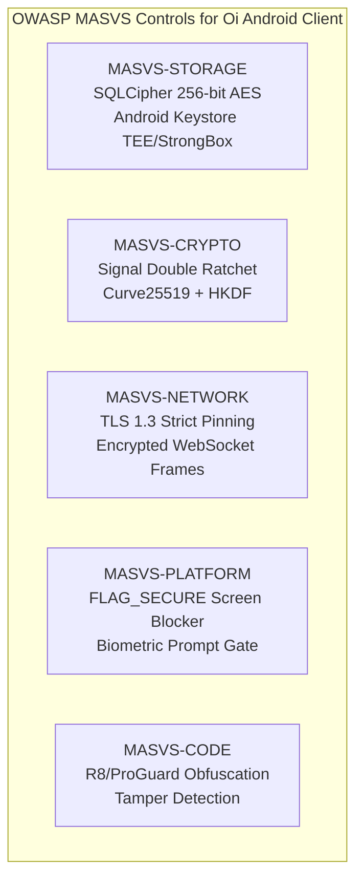
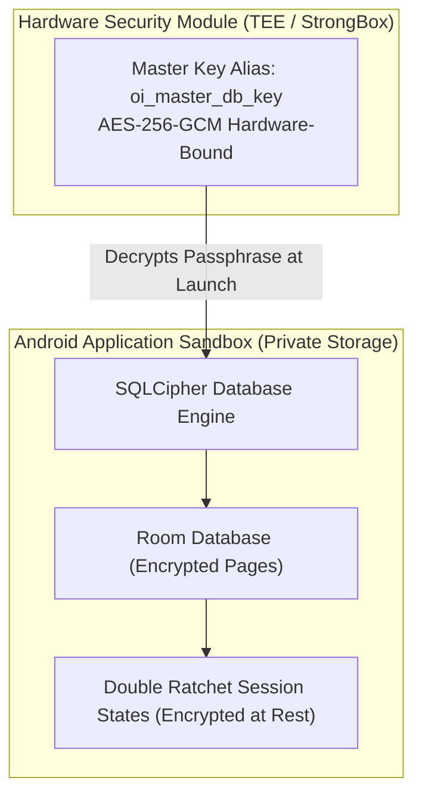

# Security, Privacy & Data Minimization Specification: Oi

> **Document ID:** SEC-006-CORE  
> **Status:** Confirmed Baseline  
> **Last Updated:** 2026-11-07  
> **Project Repository:** `https://github.com/shanuthchimbli/oisocialapp`  
> **Author:** Security Architect & Cryptographic Engineer  
> **Traceability Upstream:** [`docs/01_PRODUCT_REQUIREMENTS.md`](file:///Users/shanuthchimbli/.gemini/antigravity/scratch/oisocialapp/docs/01_PRODUCT_REQUIREMENTS.md)  
> **Compliance Standards:** OWASP MASVS v2.0, OWASP ASVS v4.0, NIST SP 800-63-3  

---

## 1. Executive Summary & Security Philosophy

**Oi** is engineered upon a foundational **Zero-Knowledge Architecture**. The platform operates under the core assumption that server networks, cloud infrastructure, and transit relays are untrusted. The security posture enforces mathematical isolation between server operators and user communications.

### Core Security Invariants
1. **Zero Plaintext Invariant:** Message plaintext and text status updates exist exclusively in volatile client RAM or within hardware-encrypted client local storage. Plaintext never touches server memory, logs, or persistent disks.
2. **Zero Backdoor Policy:** There are no lawful interception backdoors, escrow master keys, or supervisory override keys. 
3. **Data Minimization by Construction:** Raw citizen identity credentials (such as Aadhaar numbers or driver's license numbers) are never stored; deduplication uses irreversible, salted cryptographic nullifiers.
4. **Third-Party Tracker Elimination:** Zero commercial ad frameworks, tracking pixels, or surveillance telemetry SDKs (e.g., no Facebook SDK, no AppsFlyer, no Google Analytics).

---

## 2. OWASP MASVS v2.0 Compliance Architecture



### MASVS Mapping & Control Specifications

| Control Area | MASVS Identifier | Technical Control Implemented in Oi |
| :--- | :--- | :--- |
| **Storage** | `MASVS-STORAGE-1` | Room local database is fully encrypted using **SQLCipher** (AES-256 in CBC/GCM mode). Encryption passphrase is generated using CSPRNG and stored in hardware Android Keystore. |
| **Storage** | `MASVS-STORAGE-2` | No sensitive data written to system logs (`Log.d`, `Log.v` stripped via R8/ProGuard in release builds). |
| **Cryptography** | `MASVS-CRYPTO-1` | Cryptographic primitives are industry-standard: Curve25519 (X25519), Ed25519 (signatures), AES-256-GCM, HKDF-SHA256, HMAC-SHA256. |
| **Cryptography** | `MASVS-CRYPTO-2` | Hardware Keystore keys are marked `PURPOSE_ENCRYPT | PURPOSE_DECRYPT` and protected by Android TEE or StrongBox Keymaster. |
| **Network** | `MASVS-NETWORK-1`| Client enforces **TLS 1.3** exclusively. Deprecated ciphers and insecure TLS versions are blocked at OkHttp socket factory level. |
| **Network** | `MASVS-NETWORK-2`| **HTTP Public Key Pinning (HPKP)**: Native OkHttp CertificatePinner pins SHA-256 digests of the server's leaf and backup intermediate CA public keys. |
| **Platform** | `MASVS-PLATFORM-1`| Sensitive screens (Chats, Identity Verification) enable `WindowManager.LayoutParams.FLAG_SECURE` to block screenshots, screen recording, and task-switcher previews. |
| **Code** | `MASVS-CODE-1` | Production APKs and AABs are obfuscated using ProGuard/R8 with dictionary name mangling, string encryption, and dead-code stripping. |

---

## 3. Cryptographic Key Management & Storage



### Key Storage Lifecycle
1. **Master Database Key:** Generated on first application launch within the `AndroidKeyStore` provider:
   ```kotlin
   KeyGenParameterSpec.Builder("oi_master_db_key", KeyProperties.PURPOSE_ENCRYPT or KeyProperties.PURPOSE_DECRYPT)
       .setBlockModes(KeyProperties.BLOCK_MODE_GCM)
       .setEncryptionPaddings(KeyProperties.ENCRYPTION_PADDING_NONE)
       .setKeySize(256)
       .setIsStrongBoxBacked(true) // Enforces StrongBox if available
       .build()
   ```
2. **Ephemeral Memory Hygiene:**
   - Plaintext message buffers are represented as mutable `ByteArray` or `CharArray` instances rather than immutable Java `String` objects.
   - Immediately following display or transmission, buffers are explicitly overwritten with zeroes: `java.util.Arrays.fill(buffer, 0.toByte())`.
3. **Key Revocation on Session Termination:**
   - When a session invalidation push is received or explicit logout occurs, the Android client calls `KeyStore.deleteEntry("oi_master_db_key")` and erases the SQLCipher database file from private app storage.

---

## 4. Privacy Architecture & Data Minimization

| Data Field | Storage Location | Retention Lifecycle | Privacy Control |
| :--- | :--- | :--- | :--- |
| **User Phone Number** | PostgreSQL User Store | Active Account Lifetime | E.164 format. Not exposed publicly; used solely for OTP auth and contact discovery. |
| **Citizen ID (Aadhaar / Passport / DL)** | **NEVER STORED** | Zero Seconds (Ephemeral RAM only) | Discarded immediately after sovereign digital signature verification. |
| **Blinded Identity Nullifier** | PostgreSQL User Store | Account Lifetime + 90 Days post-deletion | Salted one-way HMAC-SHA256 hash. Cannot be reversed to citizen ID. |
| **Message Plaintext** | Recipient & Sender Device | Max 365 Days | Encrypted with SQLCipher. Server never sees plaintext. |
| **Message Ciphertext in Transit** | Server Redis / PostgreSQL | Until Delivered or Max 30 Days | Erased immediately upon recipient delivery receipt. |
| **Text Status** | Server Redis / Client DB | Until Manually Replaced / Deleted | Encrypted or privacy-gated to approved mutual contacts only. |
| **IP Addresses in Logs** | Server Access Logs | Max 7 Days (Security Monitoring) | Anonymized via last-octet masking (`192.168.1.xxx`). |

---

## 5. Client Application Hardening

### 5.1 Root and Integrity Verification
- **Google Play Integrity API:** Prior to initiating phone authentication or identity upload, the Android app verifies device integrity using Play Integrity API tokens.
- **Root Detection:** The client verifies safety checks (checking for su binaries, Magisk handles, test-keys build tags, and writable `/system` partitions).
- **Compromised Device Handling:** If device tampering or root access is detected, the app displays a non-dismissible security warning: *"Oi requires a verified, untampered device environment to guarantee end-to-end encryption integrity."*

### 5.2 Network Eavesdropping Protection
- **Cleartext Traffic Banned:** Android manifest strictly configures `android:usesCleartextTraffic="false"`.
- **Certificate Pinning Configuration:**
  ```kotlin
  val certificatePinner = CertificatePinner.Builder()
      .add("api.oi.chat", "sha256/k2oTQLj4ns2mtqgIpoqqQ8PwymoBQ5TFvOm3gUohmYo=") // Leaf
      .add("api.oi.chat", "sha256/r/m0WaNuukvfWitJNnmGQedHvOTxRXDTnfihSWOvnvw=") // Backup
      .build()
  ```

---

## 6. Incident Response & Vulnerability Disclosure

1. **Vulnerability Disclosure Policy:** A publicly accessible `security.txt` file (RFC 9116) at `https://oi.chat/.well-known/security.txt` provides PGP keys and response commitments ($\le 24\text{ hours}$).
2. **Emergency Revocation Protocol:** In the event of a verified compromise of a cryptographic prekey pool or signing key, the server can issue an automated client update signal invalidating affected prekey bundles.
