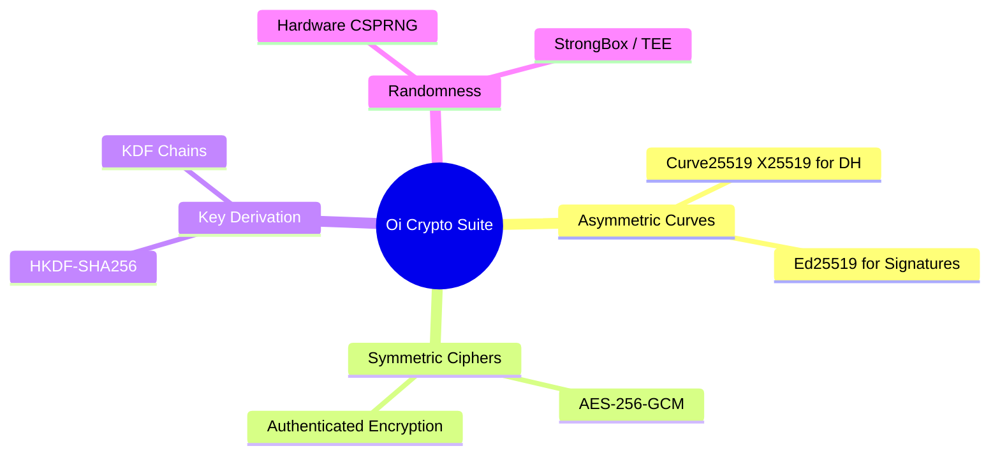
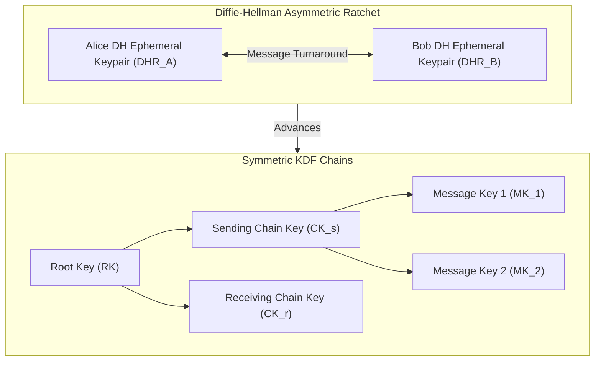

# End-to-End Encryption (E2EE) Protocol Specification: Oi

> **Document ID:** CRYPTO-007-CORE  
> **Status:** Confirmed Baseline  
> **Last Updated:** 2026-11-07  
> **Project Repository:** `https://github.com/shanuthchimbli/oisocialapp`  
> **Author:** Senior Cryptographic Engineer & Lead Architect  
> **Traceability Upstream:** [`docs/01_PRODUCT_REQUIREMENTS.md`](file:///Users/shanuthchimbli/.gemini/antigravity/scratch/oisocialapp/docs/01_PRODUCT_REQUIREMENTS.md) (`PRD-006`)  
> **Theoretical Foundation:** Signal Double Ratchet Algorithm & Extended Triple Diffie-Hellman (X3DH)  

---

## 1. Executive Summary & Cryptographic Objectives

All 1:1 private messages and contact-restricted status updates in **Oi** are cryptographically protected by genuine, zero-knowledge End-to-End Encryption. The server relays act solely as blind ciphertext conduits and possess zero capability to inspect, derive, or recover message plaintext.

### Core Cryptographic Properties
1. **Confidentiality:** Only the intended recipient holding the paired private ratchet key can decrypt message ciphertext.
2. **Integrity & Authenticity:** Messages are encrypted using **AES-256-GCM** or **ChaCha20-Poly1305**; tampering or truncation produces an authentication tag mismatch and is rejected.
3. **Forward Secrecy (FS):** Compromise of long-term identity keys at time $t$ does not permit decryption of ciphertext transmitted prior to $t$.
4. **Post-Compromise Security (PCS):** If an active ratchet state is temporarily leaked at time $t$, session security is automatically restored at $t+1$ as soon as a new asymmetric Diffie-Hellman ratchet exchange occurs.
5. **No Employee Backdoor:** The protocol contains zero lawful intercept keys, master escrow keys, or supervisory recovery modes.

---

## 2. Cryptographic Primitives & Parameters



| Function | Primitive Specification | Standard / Reference |
| :--- | :--- | :--- |
| **Diffie-Hellman Key Exchange** | **Curve25519 (X25519)** | RFC 7748 |
| **Digital Signatures** | **Ed25519** | RFC 8032 |
| **Key Derivation Function** | **HKDF-SHA256** | RFC 5869 |
| **Authenticated Symmetric Encryption**| **AES-256-GCM** (128-bit authentication tag) | NIST SP 800-38D |
| **Entropy Generation** | Android `SecureRandom` backed by Linux `/dev/urandom` & Hardware TRNG | NIST SP 800-90A |

---

## 3. Asynchronous Session Establishment: X3DH Protocol

When Alice initiates a conversation with Bob (who may be offline), Alice establishes a shared secret key ($SK$) via **Extended Triple Diffie-Hellman (X3DH)** using Bob's prekey bundle fetched from the server.

```mermaid
sequenceDiagram
    autonumber
    actor Alice as Alice (Initiator)
    participant Server as Oi Server (Key Directory)
    actor Bob as Bob (Recipient)

    Note over Bob: Bob registers Prekey Bundle with Server
    Bob->>Server: Publish: IK_B, SPK_B, Sig(IK_B, SPK_B), OPK_B_1...OPK_B_n
    
    Note over Alice: Alice prepares to message Bob
    Alice->>Server: Request Prekey Bundle for Bob (UUIDv7)
    Server-->>Alice: Returns: IK_B, SPK_B, Sig_B, OPK_B (Single-use, deleted from server)
    
    Alice->>Alice: 1. Verify Sig(IK_B, SPK_B)
    Alice->>Alice: 2. Generate Ephemeral Keypair (EK_A)
    Alice->>Alice: 3. Compute 4 Diffie-Hellman Exchanges:
    Alice->>Alice: DH1 = X25519(IK_A, SPK_B)
    Alice->>Alice: DH2 = X25519(EK_A, IK_B)
    Alice->>Alice: DH3 = X25519(EK_A, SPK_B)
    Alice->>Alice: DH4 = X25519(EK_A, OPK_B)
    Alice->>Alice: 4. Derive Shared Master Secret: SK = HKDF(DH1 || DH2 || DH3 || DH4)
    Alice->>Server: Transmit First Message with X3DH Header (IK_A, EK_A, OPK_B_ID)
    Server->>Bob: Forward Message Frame to Bob
    
    Note over Bob: Bob receives initial message
    Bob->>Bob: Computes matching DH1, DH2, DH3, DH4 using his private keys
    Bob->>Bob: Derives identical SK = HKDF(...)
    Bob->>Bob: Decrypts message ciphertext; deletes OPK_B
```

### Mathematical Formulation of X3DH Shared Secret
$$SK = \text{HKDF-SHA256}\Big(\text{F}_{\text{info}}, DH_1 \parallel DH_2 \parallel DH_3 \parallel DH_4\Big)$$
where:
$$\begin{aligned}
DH_1 &= \text{X25519}(IK_A^{\text{priv}}, SPK_B^{\text{pub}}) \\
DH_2 &= \text{X25519}(EK_A^{\text{priv}}, IK_B^{\text{pub}}) \\
DH_3 &= \text{X25519}(EK_A^{\text{priv}}, SPK_B^{\text{pub}}) \\
DH_4 &= \text{X25519}(EK_A^{\text{priv}}, OPK_B^{\text{pub}})
\end{aligned}$$

---

## 4. Message Ratcheting: The Double Ratchet Algorithm

Once the shared master secret $SK$ is established, Alice and Bob transition all subsequent messaging to the **Double Ratchet Algorithm**.



### 4.1 Symmetric Key Ratchet (KDF Chains)
For each message sent within a conversational turn, the sending KDF chain advances:
$$\begin{aligned}
CK_{i+1}, MK_i &= \text{KDF}_{\text{CK}}(CK_i) \\
\text{Ciphertext}_i &= \text{AES-256-GCM}_{MK_i}(\text{Plaintext}_i, \text{AssociatedData})
\end{aligned}$$
- As soon as $MK_i$ is used to encrypt or decrypt, it is **immediately overwritten with zeroes** in memory.
- An attacker compromising $CK_{i+1}$ cannot compute past message keys ($MK_{i-1}, MK_{i-2}$), ensuring **Forward Secrecy**.

### 4.2 Asymmetric Diffie-Hellman Ratchet
When conversational turns alternate (e.g., Bob replies to Alice), a new Curve25519 ephemeral keypair is generated and included in the message header. A new Diffie-Hellman exchange occurs:
$$RK_{new}, CK_{new} = \text{KDF}_{\text{RK}}\Big(RK_{prev}, \text{X25519}(DHR_{\text{local}}^{\text{priv}}, DHR_{\text{remote}}^{\text{pub}})\Big)$$
- This step injects fresh cryptographic entropy into the root key, achieving **Post-Compromise Security (Break-in Recovery)**.

---

## 5. Message Envelope & Wire Format

Every encrypted message transmitted across the WebSocket network is framed in a compact binary protocol:

```text
+-----------------------------------------------------------------------+
| Version (1 byte) | Sender Account UUIDv7 (16 bytes)                   |
+-----------------------------------------------------------------------+
| Recipient Account UUIDv7 (16 bytes)                                   |
+-----------------------------------------------------------------------+
| Ephemeral DH Public Key (32 bytes)                                    |
+-----------------------------------------------------------------------+
| Ratchet Sequence Number (4 bytes) | Previous Counter (4 bytes)        |
+-----------------------------------------------------------------------+
| IV / Nonce (12 bytes)                                                 |
+-----------------------------------------------------------------------+
| Ciphertext Payload (Variable: 1 to 4096 bytes)                        |
+-----------------------------------------------------------------------+
| GCM Authentication Tag (16 bytes)                                     |
+-----------------------------------------------------------------------+
```

### Associated Data (AD) Binding
To prevent replay and ciphertext redirection attacks, the AES-256-GCM Associated Data ($AD$) binds the immutable protocol envelope:
$$AD = \text{Version} \parallel \text{SenderUUIDv7} \parallel \text{RecipientUUIDv7} \parallel \text{RatchetSeqNum}$$
Any tampering with sender, recipient, or sequence causes GCM tag validation to fail, immediately dropping the malicious packet.

---

## 6. Single-Device Implications & Keystore Zeroization

Because Oi enforces **One Active Device per Account**:
1. **Device Migration:** When a user logs in on a new device (Device B), Device B generates an entirely new identity keypair and prekey bundle.
2. **Session Reset:** Device B uploads the new prekey bundle to the server. Active conversations with contacts undergo a cryptographic session re-initialization (new X3DH exchange) upon the first message.
3. **Hardware Zeroization on Old Device:**
   - Upon receiving the `SESSION_TERMINATED` high-priority FCM signal, Device A immediately zeroes all ratchet keys in RAM and calls:
     ```kotlin
     keyStore.deleteEntry("oi_master_db_key")
     ```
   - All historical local messages stored in SQLCipher become mathematically unrecoverable on Device A.
