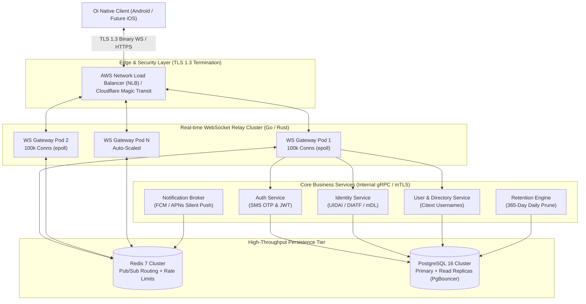
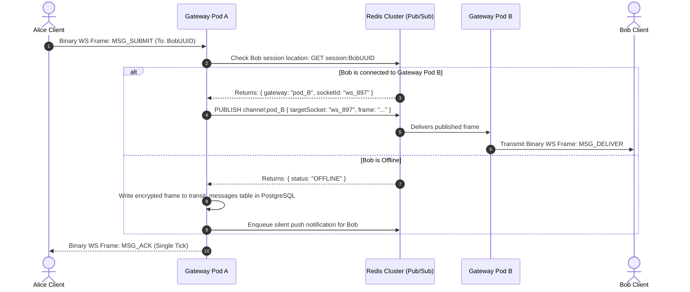

# Distributed System Architecture Specification: Oi

> **Document ID:** ARCH-008-CORE  
> **Status:** Confirmed Baseline  
> **Last Updated:** 2026-11-07  
> **Project Repository:** `https://github.com/shanuthchimbli/oisocialapp`  
> **Author:** Lead Systems Architect & Infrastructure Engineer  
> **Traceability Upstream:** [`docs/01_PRODUCT_REQUIREMENTS.md`](file:///Users/shanuthchimbli/.gemini/antigravity/scratch/oisocialapp/docs/01_PRODUCT_REQUIREMENTS.md), [`docs/04_NON_FUNCTIONAL_REQUIREMENTS.md`](file:///Users/shanuthchimbli/.gemini/antigravity/scratch/oisocialapp/docs/04_NON_FUNCTIONAL_REQUIREMENTS.md)  

---

## 1. Executive Summary & Architectural Principles

The **Oi** backend is engineered as a hyper-efficient, resilient, horizontally scalable distributed system. Because the platform enforces pure text-only communication and genuine zero-knowledge end-to-end encryption, the backend is liberated from heavy multimedia transcoding pipelines, high-bandwidth CDNs, and petabyte-scale blob storage.

---

## 2. Core Service Boundaries

### 2.1 Real-Time WebSocket Gateway Relay (`oi-gateway`)
- **Technology Stack:** Go (using `fasthttp`/`gobwas/ws`) or Rust (using `tokio`/`axum`).
- **Core Function:** Manages long-lived persistent bidirectional TCP connections over TLS 1.3.
- **Concurrency Performance:** Supports $\ge 100{,}000$ concurrent idle WebSocket connections per 4 vCPU node using non-blocking I/O (`epoll` on Linux).
- **Zero-Plaintext Invariant:** The gateway inspects only binary protocol framing headers (envelope version, sender UUIDv7, recipient UUIDv7). The encrypted ciphertext payload is routed untouched.

### 2.2 Authentication & Session Service (`oi-auth`)
- **Core Function:** Governs international phone number parsing, regional SMS OTP dispatch, rate-limiting, and cryptographic session token issuance.
- **Session Enforcement:** Maintains the single-active-device invariant. When a new device authenticates, `oi-auth` issues an atomic revocation transaction across Redis and PostgreSQL.

### 2.3 Sovereign Identity Engine (`oi-identity`)
- **Core Function:** Verifies sovereign identity proofs (UIDAI Offline XML RSA-2048 signatures, UK DIATF assertions, US mDL credentials).
- **Data Minimization:** Operates entirely in volatile RAM. Extracts demographic match, computes the Blinded Identity Nullifier, checks uniqueness in PostgreSQL, and immediately zeroizes raw credential buffers.

### 2.4 User & Directory Service (`oi-user`)
- **Core Function:** Manages unique usernames, display names, contact discovery, 180-day username quarantine lifecycles, and user block/report relationships.

### 2.5 Data-Only Push Broker (`oi-push`)
- **Core Function:** Subscribes to Redis notification queues. When a recipient is offline from WebSocket relays, `oi-push` dispatches a high-priority data-only push via Firebase Cloud Messaging (FCM) or Apple Push Notification service (APNs).
- **Zero Leakage:** Push payloads contain zero message content or sender display names.

### 2.6 Retention & Data Lifecycle Engine (`oi-purge`)
- **Core Function:** Scheduled background worker running daily at 03:00 UTC. Executes hard physical deletes on transit messages older than 30 days and verifies 365-day database retention bounds.

---

## 3. Distributed Message Routing via Redis Pub/Sub

When Alice sends a message to Bob across the distributed gateway cluster:

---

## 4. Single Developer Operational Architecture

To guarantee that the entire infrastructure is manageable, observable, and deployable by a single primary full-stack engineer:
1. **Containerized Monorepo:** Clean service separation within a single GitHub repository. Services share common Go/Rust protobuf libraries for wire serialization.
2. **Infrastructure as Code (IaC):** 100% automated deployment using **Terraform** targeting AWS (EKS / ECS Fargate, RDS PostgreSQL Multi-AZ, ElastiCache Redis).
3. **Stateless Scale:** All API and gateway services are strictly stateless. Any node can crash, be killed, or auto-scale without data corruption or state loss.
4. **Managed Backends:** Zero self-hosted database engines. Relies exclusively on managed cloud services with automated automated failover, patching, and continuous backups (RDS PITR).
