# Relational & Local Database Design Specification: Oi

> **Document ID:** DB-009-CORE  
> **Status:** Confirmed Baseline  
> **Last Updated:** 2026-11-07  
> **Project Repository:** `https://github.com/shanuthchimbli/oisocialapp`  
> **Author:** Database Architect & Lead Systems Engineer  
> **Primary Technology:** PostgreSQL 16+ (Server) & Room with SQLCipher (Android Client)  
> **Traceability Upstream:** [`docs/01_PRODUCT_REQUIREMENTS.md`](file:///Users/shanuthchimbli/.gemini/antigravity/scratch/oisocialapp/docs/01_PRODUCT_REQUIREMENTS.md), [`docs/08_SYSTEM_ARCHITECTURE.md`](file:///Users/shanuthchimbli/.gemini/antigravity/scratch/oisocialapp/docs/08_SYSTEM_ARCHITECTURE.md)  

---

## 1. Executive Summary & Design Principles

The **Oi** data architecture spans two distinct, strictly decoupled persistence domains:
1. **Central Server Persistence (PostgreSQL 16):** Stores only identity nullifiers, account state, public cryptographic prekeys, transient offline message ciphertext, and metadata. Server tables store **zero message plaintext**.
2. **Local Client Persistence (Room / SQLCipher):** Stores decrypted conversation history, local ratchets, and cached contacts within a hardware-encrypted SQLite sandbox.

---

## 2. Server Database Schema: PostgreSQL 16

```mermaid
erDiagram
    users ||--o{ usernames : "owns"
    users ||--o{ devices : "has active"
    users ||--o{ prekey_bundles : "publishes"
    users ||--o{ one_time_prekeys : "provides"
    users ||--o{ transit_messages : "sends/receives"
    users ||--o| status_updates : "publishes"
    users ||--o{ blocked_users : "blocks"
    users ||--o{ username_quarantine : "quarantines"

    users {
        uuid id PK "UUIDv7 (Permanent Account ID)"
        varchar phone_number "E.164 (+91, +44, +1)"
        varchar display_name "1-50 chars"
        enum account_state "PROVISIONAL | VERIFIED | SUSPENDED | CLOSED"
        char identity_nullifier "64-byte HMAC-SHA256 (UNIQUE)"
        timestamptz grace_expiry "Registration + 14 Days"
        timestamptz created_at
        timestamptz updated_at
    }

    usernames {
        citext username PK "3-30 chars (Case-Insensitive)"
        uuid user_id FK "References users(id)"
        boolean is_active "True if currently active handle"
        timestamptz assigned_at
    }

    username_quarantine {
        citext username PK
        uuid prior_user_id FK "References users(id)"
        timestamptz quarantined_at
        timestamptz eligible_release_at "Quarantine + 180 Days"
    }

    devices {
        uuid id PK "UUIDv7"
        uuid user_id FK "References users(id)"
        varchar device_fingerprint "Hardware-bound hash"
        varchar push_token "FCM / APNs Token"
        boolean is_active "Enforces 1 Active Device"
        timestamptz registered_at
        timestamptz last_seen_at
    }

    prekey_bundles {
        uuid user_id PK, FK "References users(id)"
        uuid device_id FK "References devices(id)"
        bytea identity_key "32-byte Ed25519 public key"
        bytea signed_prekey "32-byte Curve25519 public key"
        bytea signed_prekey_sig "64-byte signature"
        timestamptz updated_at
    }

    transit_messages {
        uuid id PK "UUIDv7 (Client Message ID)"
        uuid sender_id FK "References users(id)"
        uuid recipient_id FK "References users(id)"
        bytea ciphertext_payload "Encrypted Double Ratchet Frame"
        enum status "QUEUED | DELIVERED | EXPIRED"
        timestamptz created_at "Enforces 30-day transit TTL"
    }

    status_updates {
        uuid user_id PK, FK "References users(id)"
        varchar status_text "1-140 UTF-8 chars"
        enum privacy_mode "CONTACTS_ONLY | NOBODY"
        timestamptz updated_at
    }

    blocked_users {
        uuid blocker_id PK, FK "References users(id)"
        uuid blocked_id PK, FK "References users(id)"
        timestamptz created_at
    }
```



---

## 3. Data DDL & Relational Invariants

### 3.1 Extensions & Types
```sql
CREATE EXTENSION IF NOT EXISTS "citext";
CREATE EXTENSION IF NOT EXISTS "pgcrypto";

CREATE TYPE account_state_enum AS ENUM ('PROVISIONAL', 'VERIFIED', 'SUSPENDED', 'CLOSED');
CREATE TYPE message_status_enum AS ENUM ('QUEUED', 'DELIVERED', 'EXPIRED');
CREATE TYPE status_privacy_enum AS ENUM ('CONTACTS_ONLY', 'NOBODY');
```

### 3.2 Core Tables & Unique Constraints
```sql
-- Permanent Users Table (Decoupled from usernames)
CREATE TABLE users (
    id UUID PRIMARY KEY, -- Time-ordered UUIDv7
    phone_number VARCHAR(20) NOT NULL UNIQUE,
    display_name VARCHAR(50) NOT NULL,
    account_state account_state_enum NOT NULL DEFAULT 'PROVISIONAL',
    identity_nullifier CHAR(64) UNIQUE, -- Salted HMAC-SHA256 of citizen ID
    grace_expiry TIMESTAMPTZ NOT NULL,
    created_at TIMESTAMPTZ NOT NULL DEFAULT NOW(),
    updated_at TIMESTAMPTZ NOT NULL DEFAULT NOW()
);

-- Unique Username System (Case-Insensitive citext)
CREATE TABLE usernames (
    username CITEXT PRIMARY KEY,
    user_id UUID NOT NULL REFERENCES users(id) ON DELETE CASCADE,
    is_active BOOLEAN NOT NULL DEFAULT TRUE,
    assigned_at TIMESTAMPTZ NOT NULL DEFAULT NOW(),
    CONSTRAINT valid_username_format CHECK (username ~ '^[a-z0-9][a-z0-9_]{1,28}[a-z0-9]$')
);

-- 180-Day Username Quarantine Table
CREATE TABLE username_quarantine (
    username CITEXT PRIMARY KEY,
    prior_user_id UUID NOT NULL REFERENCES users(id) ON DELETE CASCADE,
    quarantined_at TIMESTAMPTZ NOT NULL DEFAULT NOW(),
    eligible_release_at TIMESTAMPTZ NOT NULL
);

-- Single Active Device Enforcement Table
CREATE TABLE devices (
    id UUID PRIMARY KEY,
    user_id UUID NOT NULL REFERENCES users(id) ON DELETE CASCADE,
    device_fingerprint VARCHAR(128) NOT NULL,
    push_token VARCHAR(256),
    is_active BOOLEAN NOT NULL DEFAULT TRUE,
    registered_at TIMESTAMPTZ NOT NULL DEFAULT NOW(),
    last_seen_at TIMESTAMPTZ NOT NULL DEFAULT NOW()
);
-- Partial Unique Index guaranteeing exactly ONE active device per account
CREATE UNIQUE INDEX idx_single_active_device ON devices (user_id) WHERE is_active = TRUE;

-- Ephemeral Message Transit Queue (Zero Plaintext)
CREATE TABLE transit_messages (
    id UUID PRIMARY KEY,
    sender_id UUID NOT NULL REFERENCES users(id),
    recipient_id UUID NOT NULL REFERENCES users(id),
    ciphertext_payload BYTEA NOT NULL,
    status message_status_enum NOT NULL DEFAULT 'QUEUED',
    created_at TIMESTAMPTZ NOT NULL DEFAULT NOW()
);
CREATE INDEX idx_transit_recipient ON transit_messages (recipient_id) WHERE status = 'QUEUED';
CREATE INDEX idx_transit_ttl ON transit_messages (created_at) WHERE status = 'QUEUED';
```

---

## 4. Client-Side SQLite Database: Room with SQLCipher

On Android, local storage is governed by **Room over SQLCipher**:

```sql
-- Client Local Message Store (Encrypted with hardware-backed AES-256-GCM)
CREATE TABLE local_messages (
    id TEXT PRIMARY KEY, -- Client UUIDv7
    conversation_id TEXT NOT NULL,
    sender_id TEXT NOT NULL,
    recipient_id TEXT NOT NULL,
    plaintext_content TEXT NOT NULL,
    state TEXT NOT NULL, -- 'SENDING', 'SENT', 'DELIVERED', 'READ'
    created_at INTEGER NOT NULL, -- Unix epoch millisecond timestamp
    FOREIGN KEY(conversation_id) REFERENCES local_conversations(id) ON DELETE CASCADE
);

-- Index for instant conversation rendering and 365-day purge execution
CREATE INDEX idx_local_msg_convo ON local_messages (conversation_id, created_at ASC);
CREATE INDEX idx_local_msg_purge ON local_messages (created_at);

-- Client Full-Text Search Virtual Table
CREATE VIRTUAL TABLE local_messages_fts USING fts5(
    id UNINDEXED,
    plaintext_content,
    content='local_messages',
    content_rowid='rowid'
);
```

---

## 5. Automated 365-Day Data Retention Execution

### 5.1 Server Transit Purge Job (Daily 03:00 UTC)
```sql
-- Purges transit messages delivered or older than 30 days
DELETE FROM transit_messages
WHERE status = 'DELIVERED' 
   OR created_at < (NOW() - INTERVAL '30 days');
```

### 5.2 Client-Side Purge Execution (Android WorkManager)
```sql
-- Purges local messages strictly exceeding 365 solar days (31,536,000 seconds)
DELETE FROM local_messages 
WHERE created_at < ((strftime('%s', 'now') - 31536000) * 1000);

-- Zeroize free space and reclaim disk pages
VACUUM;
```
