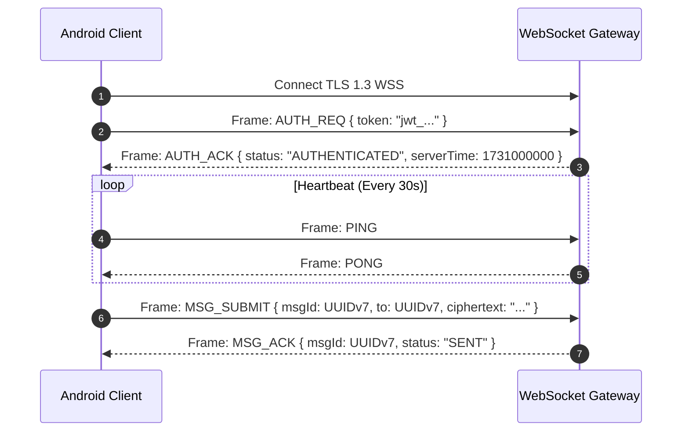

# API & Real-Time Protocol Specification: Oi

> **Document ID:** API-010-CORE  
> **Status:** Confirmed Baseline  
> **Last Updated:** 2026-11-07  
> **Project Repository:** `https://github.com/shanuthchimbli/oisocialapp`  
> **Author:** Lead API Architect & Backend Engineer  
> **Protocol Stack:** HTTPS (REST) & WebSockets (RFC 6455) over TLS 1.3  
> **Traceability Upstream:** [`docs/01_PRODUCT_REQUIREMENTS.md`](file:///Users/shanuthchimbli/.gemini/antigravity/scratch/oisocialapp/docs/01_PRODUCT_REQUIREMENTS.md), [`docs/08_SYSTEM_ARCHITECTURE.md`](file:///Users/shanuthchimbli/.gemini/antigravity/scratch/oisocialapp/docs/08_SYSTEM_ARCHITECTURE.md)  

---

## 1. Executive Summary & Design Conventions

The **Oi** application uses a dual-protocol architecture:
1. **RESTful HTTPS (JSON) Endpoints:** Used for stateless operations including phone authentication, sovereign identity verification, username checks, and profile management.
2. **Persistent Bidirectional WebSockets (WSS):** Used exclusively for real-time encrypted message routing, delivery receipts, read receipts, and session heartbeat telemetry.

### Universal Protocol Standards
- **Transport Security:** Strict **TLS 1.3** only.
- **Authentication:** `Authorization: Bearer <jwt_access_token>`. Short-lived (15 minutes); refreshed via secure HTTP-only refresh tokens.
- **Idempotency:** All mutating `POST` and `PUT` endpoints accept an `Idempotency-Key: <uuidv7>` header.
- **Standardized Error Envelope:**
  ```json
  {
    "error": {
      "code": "ERR_USERNAME_TAKEN",
      "message": "The requested username is already registered to another user.",
      "timestamp": "2026-11-07T17:00:00Z",
      "traceId": "c8a49df2-51a7-47c3-8820-22c61c47012f"
    }
  }
  ```

---

## 2. RESTful API Contracts

### 2.1 Authentication Endpoints

#### `POST /v1/auth/phone/otp-request`
- **Rate Limit:** 3 per phone number per hour; 10 per IP per hour.
- **Request Body:**
  ```json
  {
    "phoneNumber": "+919876543210",
    "deviceFingerprint": "a9f8b2c4e1..."
  }
  ```
- **Response (200 OK):**
  ```json
  {
    "requestId": "req_8df729bc14a0",
    "resendCooldownSeconds": 60,
    "expiresInSeconds": 300
  }
  ```

#### `POST /v1/auth/phone/otp-verify`
- **Request Body:**
  ```json
  {
    "requestId": "req_8df729bc14a0",
    "otp": "748291",
    "deviceFingerprint": "a9f8b2c4e1...",
    "pushToken": "fcm_token_xyz..."
  }
  ```
- **Response (200 OK):**
  ```json
  {
    "sessionToken": "eyJhbGciOi...",
    "refreshToken": "rt_98ab7c...",
    "expiresIn": 900,
    "user": {
      "id": "018e69e4-bc23-7188-b769-cfbb98b846e1",
      "phoneNumber": "+919876543210",
      "displayName": "Aarav Sharma",
      "username": "aarav",
      "accountState": "PROVISIONAL",
      "graceExpiry": "2026-11-21T17:00:00Z"
    }
  }
  ```

---

### 2.2 Sovereign Identity Verification Endpoints

#### `POST /v1/identity/verify/uidai-xml` (India)
- **Request (Multipart/form-data):**
  - `xmlZip`: Encrypted ZIP containing Aadhaar Paperless Offline XML.
  - `shareCode`: 4-digit resident PIN (e.g., `"1984"`).
- **Processing:** Validates UIDAI RSA-2048 digital signature; checks freshness ($\le 72\text{ hours}$); derives HMAC-SHA256 nullifier; checks database uniqueness; zeroizes XML.
- **Response (200 OK):**
  ```json
  {
    "status": "VERIFIED",
    "verifiedAt": "2026-11-07T17:02:15Z",
    "verificationBadge": true
  }
  ```
- **Error Response (409 Conflict):**
  ```json
  {
    "error": {
      "code": "ERR_IDENTITY_DUPLICATE",
      "message": "This government identity is already registered to an existing Oi account."
    }
  }
  ```

---

### 2.3 Username & Profile Endpoints

#### `GET /v1/users/username-check?u=handle`
- **Query Param:** `u` (3 to 30 lowercase alphanumeric chars).
- **Response (200 OK):**
  ```json
  {
    "username": "handle",
    "isAvailable": true,
    "isReserved": false
  }
  ```

#### `PUT /v1/users/username-update`
- **Constraint:** Rate-limited to once every 30 calendar days.
- **Request Body:**
  ```json
  {
    "newUsername": "new_handle"
  }
  ```
- **Response (200 OK):**
  ```json
  {
    "username": "new_handle",
    "cooldownUntil": "2026-12-07T17:00:00Z"
  }
  ```

---

### 2.4 Status Update Endpoints (Text-Only)

#### `PUT /v1/status`
- **Request Body:**
  ```json
  {
    "statusText": "In court hearings today. Text only.",
    "privacyMode": "CONTACTS_ONLY"
  }
  ```
- **Response (200 OK):**
  ```json
  {
    "statusText": "In court hearings today. Text only.",
    "updatedAt": "2026-11-07T17:05:00Z"
  }
  ```

#### `DELETE /v1/status`
- **Response (204 No Content):** Status erased from Redis and PostgreSQL.

---

## 3. Real-Time WebSocket Protocol (RFC 6455)

The WebSocket connection operates at endpoint `wss://api.oi.chat/v1/ws`. All messages are encoded as lightweight binary or JSON framing envelopes.



### WebSocket Frame Schema Catalog

| Frame Opcode | Direction | Payload Attributes | Semantic Meaning |
| :--- | :---: | :--- | :--- |
| `AUTH_REQ` | Client $\to$ Server | `{ "token": "jwt_..." }` | Authenticates socket connection. |
| `AUTH_ACK` | Server $\to$ Client | `{ "status": "AUTHENTICATED" }` | Confirms session authorization. |
| `MSG_SUBMIT` | Client $\to$ Server | `{ "msgId": UUID, "to": UUID, "ciphertext": "...", "seq": 42 }` | Submits encrypted message frame. |
| `MSG_ACK` | Server $\to$ Client | `{ "msgId": UUID, "status": "SENT", "serverSeq": 1098 }` | Acknowledges receipt at server (Single Tick). |
| `MSG_DELIVER` | Server $\to$ Client | `{ "msgId": UUID, "from": UUID, "ciphertext": "...", "seq": 42 }` | Routes encrypted frame to recipient. |
| `MSG_DELIVERED_ACK` | Client $\to$ Server | `{ "msgId": UUID }` | Recipient confirms device delivery. |
| `MSG_DELIVERED_RECEIPT` | Server $\to$ Client | `{ "msgId": UUID }` | Sender notified of device delivery (Double Tick). |
| `MSG_READ_ACK` | Client $\to$ Server | `{ "msgId": UUID }` | Recipient opened conversation. |
| `MSG_READ_RECEIPT` | Server $\to$ Client | `{ "msgId": UUID }` | Sender notified of read state (Blue/Solid Tick). |
| `SESSION_TERMINATED` | Server $\to$ Client | `{ "reason": "NEW_DEVICE_LOGIN" }` | Informs client of remote session kill. |
