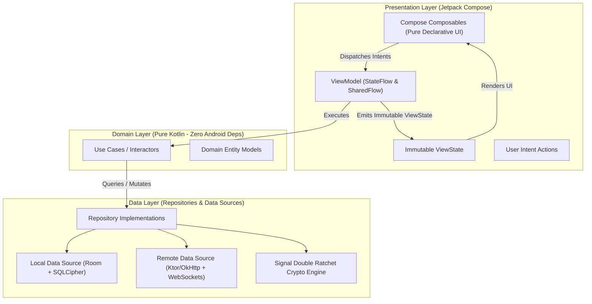
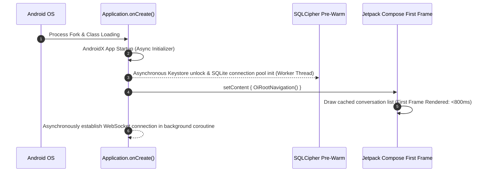

# Native Android Kotlin & Jetpack Compose Architecture: Oi

> **Document ID:** ANDROID-011-CORE  
> **Status:** Confirmed Baseline  
> **Last Updated:** 2026-11-07  
> **Project Repository:** `https://github.com/shanuthchimbli/oisocialapp`  
> **Author:** Mobile Systems Architect & Android Lead  
> **Target SDK:** Android 14 (API 34) | Minimum SDK: Android 8.0 (API 26)  
> **Language & UI:** Kotlin 2.x & Jetpack Compose  
> **Traceability Upstream:** [`docs/01_PRODUCT_REQUIREMENTS.md`](file:///Users/shanuthchimbli/.gemini/antigravity/scratch/oisocialapp/docs/01_PRODUCT_REQUIREMENTS.md), [`docs/04_NON_FUNCTIONAL_REQUIREMENTS.md`](file:///Users/shanuthchimbli/.gemini/antigravity/scratch/oisocialapp/docs/04_NON_FUNCTIONAL_REQUIREMENTS.md)  

---

## 1. Executive Summary & Architectural Pattern

The **Oi** Android client is engineered strictly as a pure native application. It rejects cross-platform abstraction frameworks (such as Flutter or React Native) to achieve uncompromised hardware TEE integration, sub-second cold starts, 60+ FPS sustained scrolling, and a tiny application bundle ($\le 15\text{ MB}$).

The codebase adheres strictly to **Clean Architecture** organized with a unidirectional **Model-View-Intent (MVI)** reactive flow.



---

## 2. Layered Module Boundaries

### 2.1 Presentation Layer (`:feature:chats`, `:feature:status`, `:feature:auth`)
- **Jetpack Compose Only:** 100% declarative UI. Zero legacy Android XML views, zero Fragments, zero synthetic view bindings.
- **Unidirectional Data Flow (MVI):**
  - **ViewState:** A single, immutable Kotlin `data class` representing the complete screen state.
  - **Intent:** Sealed classes representing discrete user gestures (`SendMessageIntent`, `DeleteStatusIntent`).
  - **SideEffect:** One-off transient events (`ShowToast`, `NavigateToLogin`).
- **Compose Stability:** All UI models are marked with `@Immutable` or `@Stable` to prevent redundant recompositions.

### 2.2 Domain Layer (`:core:domain`)
- **Pure Kotlin:** Contains zero references to `android.*` packages.
- **Use Cases:** Granular, single-responsibility interactors (e.g., `SendMessageUseCase`, `VerifyUidaiXmlUseCase`, `PurgeExpiredMessagesUseCase`).
- **Complete Testability:** 100% unit-testable on local JVMs in milliseconds without Android instrumentation overhead.

### 2.3 Data Layer (`:core:data`, `:core:database`, `:core:network`)
- **Offline-First Repository Pattern:** The UI layer observes local database streams exclusively (`Flow<List<Message>>`). Remote WebSocket arrivals write directly to Room; Room triggers reactive UI updates.
- **Room over SQLCipher:** SQLite database pages, WAL logs, and temp files are encrypted using hardware-backed 256-bit AES-GCM.
- **Crypto Engine:** Local C/Rust native JNI bindings for Curve25519, Ed25519, and Signal Double Ratchet ratchets.

---

## 3. High-Performance Startup Optimization (Cold Launch $< 800\text{ ms}$)

To achieve the sub-second cold launch SLA (`PERF-001`):



### Startup Rules:
1. **Zero Main-Thread Blocking:** Database migrations, keystore cryptographic derivations, and network socket allocations are strictly barred from `Application.onCreate()` on the main thread.
2. **AndroidX App Startup:** Uses `androidx.startup.InitializationProvider` to lazily pre-warm singletons.
3. **Baseline Profiles:** Generates ahead-of-time (AOT) compiled ART execution profiles via Android `Macrobenchmark` to eliminate runtime JIT compilation stalls during launch.

---

## 4. WorkManager & Background Sync Engine

The app utilizes **Android Jetpack WorkManager** with strict battery and network constraints:

```kotlin
// Daily 365-Day Retention Purge Worker
class RetentionPurgeWorker(context: Context, params: WorkerParameters) : CoroutineWorker(context, params) {
    override suspend fun doWork(): Result = withContext(Dispatchers.IO) {
        val database = getEncryptedDatabase()
        val oneYearAgoMillis = System.currentTimeMillis() - (365L * 24 * 60 * 60 * 1000)
        
        database.messageDao().deleteOlderThan(oneYearAgoMillis)
        database.openHelper.writableDatabase.execSQL("VACUUM")
        Result.success()
    }
}
```

- Scheduled via `PeriodicWorkRequestBuilder<RetentionPurgeWorker>(24, TimeUnit.HOURS)` with constraints: `setRequiresDeviceIdle(true)` and `setRequiresBatteryNotLow(true)`.
- The SQLCipher passphrase is generated randomly once, wrapped with an Android Keystore AES-GCM key, and reused by the application and retention worker. Never use a hard-coded passphrase or destructive migration fallback.

### Input Validation

- Phone numbers are parsed and validated with Google's `libphonenumber` for the selected launch jurisdiction and must round-trip to strict E.164 format.
- Status text is limited to 140 Unicode code points and rejects blank content, HTML tags, Markdown links, and URLs. Messages are limited to 4,096 Unicode code points. Invalid drafts remain visible for correction and are not submitted.

---

## 5. Security & Hardware Keystore Integration

1. **Window Protection:** Sensitive activities enforce:
   ```kotlin
   window.setFlags(
       WindowManager.LayoutParams.FLAG_SECURE,
       WindowManager.LayoutParams.FLAG_SECURE
   )
   ```
2. **Biometric Auth Integration:** Optional biometric gate backed by `BiometricPrompt` with `BIOMETRIC_STRONG` crypto-object binding.
3. **ProGuard / R8 Rules:** Production builds strip all log calls and aggressively obfuscate class/method signatures.
