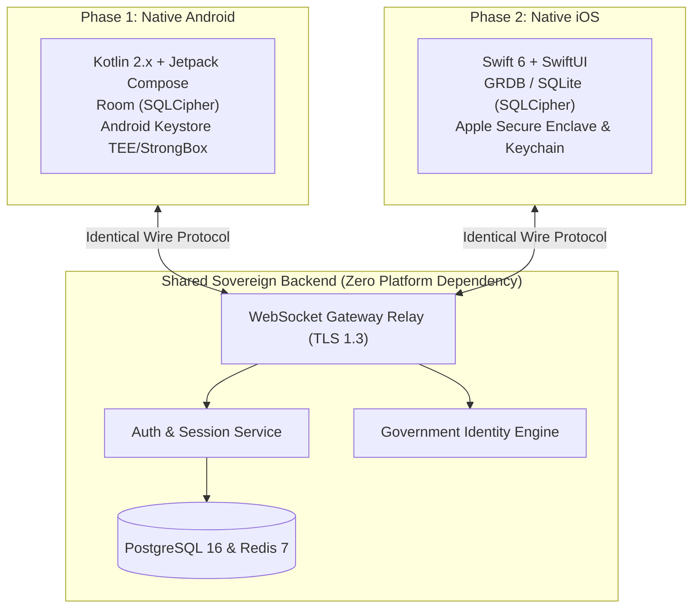

# Cross-Platform Portability & iOS Architecture Strategy: Oi

> **Document ID:** PORT-012-CORE  
> **Status:** Confirmed Baseline  
> **Last Updated:** 2026-11-07  
> **Project Repository:** `https://github.com/shanuthchimbli/oisocialapp`  
> **Author:** Mobile Systems Architect & Lead Cross-Platform Engineer  
> **Phase Timing:** Phase 1 (Native Android) $\to$ Phase 2 (Native iOS)  
> **Traceability Upstream:** [`docs/00_PROJECT_CHARTER.md`](file:///Users/shanuthchimbli/.gemini/antigravity/scratch/oisocialapp/docs/00_PROJECT_CHARTER.md), [`docs/01_PRODUCT_REQUIREMENTS.md`](file:///Users/shanuthchimbli/.gemini/antigravity/scratch/oisocialapp/docs/01_PRODUCT_REQUIREMENTS.md)  

---

## 1. Executive Summary & Zero-Backend-Rewrite Guarantee

A mandatory product requirement for **Oi** is that the application must initially launch as a native Android client while ensuring that a future native iOS application can deploy seamlessly **without requiring redesign or refactoring of the backend services, database models, or communication protocols**.

---

## 2. Platform-Agnostic Protocol & Contract Parity

To ensure that the backend remains completely decoupled from Android-specific idioms:

| Architectural Domain | Platform-Agnostic Standard | Android Realization (Phase 1) | iOS Realization (Phase 2) |
| :--- | :--- | :--- | :--- |
| **REST & Serialization** | Strict JSON schema over HTTPS (TLS 1.3) | `kotlinx.serialization` with OkHttp | Swift `Codable` with `URLSession` |
| **Real-Time Messaging** | Binary WebSocket frames (RFC 6455) | Ktor WebSocket / OkHttp | `URLSessionWebSocketTask` |
| **End-to-End Encryption**| Signal Double Ratchet + X3DH (Curve25519) | C/Rust JNI bindings (`libsignal`) | Swift C-interop (`libsignal-protocol-swift`) |
| **Local Data Persistence**| SQLite with SQLCipher (256-bit AES-GCM) | Android Room with SQLCipher | `GRDB.swift` with SQLCipher |
| **Hardware Key Storage** | Hardware Security Module (TEE / SE) | Android Keystore (StrongBox) | Apple Secure Enclave & Keychain |
| **Silent Wakeup Push** | Data-only push with encrypted message ID | Firebase Cloud Messaging (FCM) | Apple Push Notification service (APNs) |
| **Screen Capture Block** | Platform window-level capture protection | `WindowManager.FLAG_SECURE` | SwiftUI `recordingRestriction` / Canvas protection |

---

## 3. Cross-Platform Session Enforcement

The **Single Active Device Invariant** operates uniformly across operating system boundaries:
1. If a user is actively authenticated on an **Android** device and subsequently completes phone authentication on an **iPhone**, the central session broker immediately revokes the Android device session.
2. The Android client receives a high-priority silent FCM push terminating its session, while the iPhone becomes the sole authorized active endpoint.
3. The server maintains zero OS preference; device sessions are identified solely by UUIDv7 and public cryptographic prekey registrations.

---

## 4. Phase 2 Native iOS Technical Architecture

When Phase 2 development initiates:
- **Language & Runtime:** Swift 6 with strict concurrency (`Sendable`, Actors).
- **UI Framework:** SwiftUI (100% declarative UI matching Jetpack Compose state architecture).
- **Pattern:** Clean Architecture with MVI / TCA (The Composable Architecture) preserving unidirectional data flow.
- **Identity Verification:**
  - USA: Direct integration with **Apple Wallet Identity API** (ISO/IEC 18013-5 verifiable digital credentials).
  - UK: DIATF assertion validation.
  - India: UIDAI Offline XML upload and parsing via native Swift XML parsers.

---

## 5. Architectural Evaluation: Kotlin Multiplatform (KMP) vs. Pure Native Swift

| Architectural Dimension | Kotlin Multiplatform (KMP) Core | Pure Native Swift Architecture | Selected Strategy |
| :--- | :--- | :--- | :--- |
| **Code Sharing** | Shares Domain Use Cases and Signal Crypto logic (~40% of codebase). | Zero code sharing; two independent client implementations. | **Proposed Option for Phase 2** |
| **Binary Overhead** | Minimal Kotlin/Native runtime (~1.5 MB). | Zero additional runtime. | Both within acceptable budgets. |
| **Native Feel & UI** | 100% Native Compose (Android) & SwiftUI (iOS). | 100% Native Compose & SwiftUI. | Parity. |
| **Developer Ergonomics** | Single developer can maintain domain logic in one place. | Requires maintaining two sets of business interactors. | KMP offers efficiency for 1 developer. |

**Decision:** The domain layer (`:core:domain`) and cryptographic state machine are written in standard, idiomatic Kotlin adhering strictly to KMP-ready idioms (pure Kotlin, zero Android imports). In Phase 2, the engineering team can either link `:core:domain` as an Apple XCFramework via KMP or mirror the interactors in Swift without altering backend contracts.
