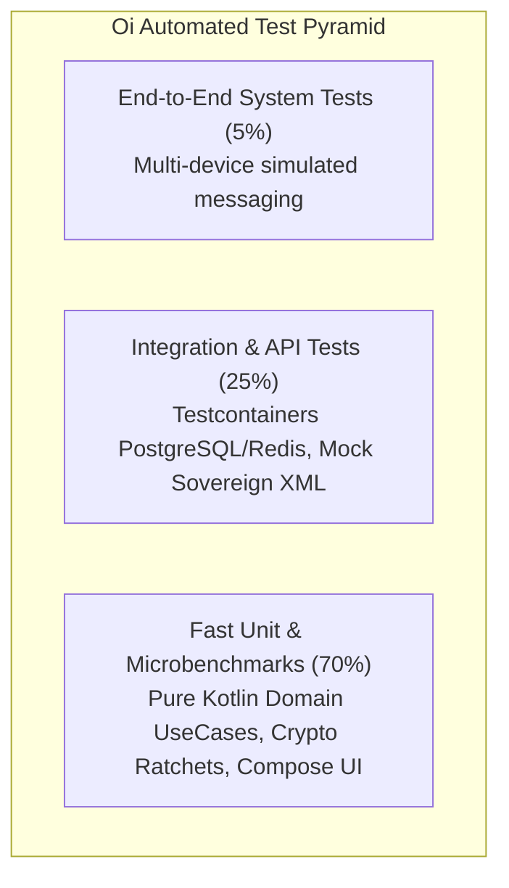

# Automated Quality Engineering & Testing Strategy: Oi

> **Document ID:** TEST-013-CORE  
> **Status:** Confirmed Baseline  
> **Last Updated:** 2026-11-07  
> **Project Repository:** `https://github.com/shanuthchimbli/oisocialapp`  
> **Author:** QA Architect & SDET Lead  
> **Traceability Upstream:** [`docs/01_PRODUCT_REQUIREMENTS.md`](file:///Users/shanuthchimbli/.gemini/antigravity/scratch/oisocialapp/docs/01_PRODUCT_REQUIREMENTS.md)  

---

## 1. Executive Summary & Quality Engineering Philosophy

To make the **Oi** platform sustainably maintainable and verifiable by **a single primary developer**, manual regression testing is replaced with an exhaustive, fully automated testing architecture. 

Every feature, cryptographic ratchet transition, database constraint, and government verification route must pass automated CI/CD quality gates before code can be merged or deployed.



---

## 2. 24 Comprehensive Testing Domains (A through X)

The automated quality architecture covers 24 discrete verification disciplines:

| Domain | Scope & Focus | Primary Tools | Execution Target |
| :--- | :--- | :--- | :--- |
| **A. Unit Testing** | Pure Kotlin Domain UseCases, MVI ViewModels, state machines | JUnit 5, MockK | Local JVM ($< 10\text{ ms}$ per test) |
| **B. Integration Testing** | Repository interactions with Room DB and network clients | Robolectric, Testcontainers | CI Pipeline ($< 3\text{ mins}$) |
| **C. API Testing** | REST contracts, payload validation, status codes, headers | REST Assured, Ktor Client | CI Pipeline |
| **D. Database Testing** | PostgreSQL constraints, citext, UUIDv7 generation, partial indexes | Testcontainers PostgreSQL 16 | CI Database Gate |
| **E. Android UI Testing** | Compose screen rendering, user interactions, text input | AndroidX Compose Test Rule | Local Emulator CI |
| **F. End-to-End Testing** | Two simulated clients exchanging E2EE messages via gateway | Custom Headless Test Clients | Nightly Integration Runner |
| **G. Authentication Testing**| SMS OTP generation, expiration, 3-attempt lock, rate limits | Automated HTTP Runner | CI Pipeline |
| **H. Identity Verification** | UIDAI XML signature verification, DIATF assertions, mDL | Synthetic Government Proofs | CI Security Runner |
| **I. Encryption Testing** | Signal Double Ratchet, X3DH, forward secrecy, break-in recovery | Cavium / Known-Answer-Tests | Cryptographic Gate |
| **J. Security Testing** | OWASP MASVS checks, certificate pinning failure, injection | OWASP ZAP, MobSF, Burp | Pre-Merge Security Scan |
| **K. Privacy Testing** | Data minimization, zero plaintext assertions in server memory | Heap Dump Assertions | Automated Memory Scraper |
| **L. Performance Testing** | Cold launch ($< 800\text{ ms}$), warm launch, optimistic UI ($< 50\text{ ms}$) | Android Macrobenchmark | Physical Test Lab Runner |
| **M. Load Testing** | Gateway capacity: 100,000 concurrent sockets per node | Locust, k6 (Distributed) | Staging Pre-Release |
| **N. Stress Testing** | Server behavior under CPU exhaustion and Redis restarts | Chaos Mesh | Staging Resilience Run |
| **O. Network Interruption** | Sudden airplane mode, cellular $\leftrightarrow$ Wi-Fi handover | Network Link Conditioner | Automated Emulator Runner |
| **P. Offline Sync Testing** | Queueing in Room, automatic sequential flush upon reconnect | Mock Network Engine | Integration Test Suite |
| **Q. Battery Testing** | Background battery drain ($\le 1.5\%$ per 24 hours) | Android Battery Historian | Release Candidate Gate |
| **R. Memory Testing** | RSS footprint ($\le 50\text{ MB}$), zero memory leaks | LeakCanary, Android Studio Profiler | CI UI Tests |
| **S. Device Compatibility** | Multiple screen densities, API 26 through API 34 | Firebase Test Lab (Virtual/Physical) | Nightly Release Runner |
| **T. Upgrade & Migration** | Room database schema migrations from version $v_n \to v_{n+1}$ | Room MigrationTestHelper | CI Database Suite |
| **U. Retention Testing** | Physical deletion of messages older than 365 days | Mock Clock Time-Shift Suite | Integration Test Suite |
| **V. Account Recovery** | Lost SIM recovery workflow using government identity re-proof | Automated State Machine | CI Pipeline |
| **W. Deployment Testing** | Blue/Green gateway deployment zero socket disconnection | Kubernetes Rolling Update Check | Staging CD Gate |
| **X. Backup & Restore** | PostgreSQL Point-in-Time Recovery (PITR) data restoration | Automated Backup Restore Script | Monthly Disaster Drill |

---

## 3. Testing Toolchain & Harness Architecture

- **Backend Testing:** Go / Rust native test runners with **Testcontainers** running genuine PostgreSQL 16 and Redis 7 container instances.
- **Android Unit Testing:** Pure Kotlin tests run in standard JVMs without booting Android runtimes.
- **Android UI & Component Testing:** Declarative tests using Compose `createComposeRule()`:
  ```kotlin
  @Test
  fun testOptimisticMessageAppearanceUnder50ms() {
      composeTestRule.setContent { ChatScreen(testConversationState) }
      composeTestRule.onNodeWithTag("message_input").performTextInput("Hello Oi")
      
      val startTime = System.currentTimeMillis()
      composeTestRule.onNodeWithTag("send_button").performClick()
      composeTestRule.onNodeWithText("Hello Oi").assertIsDisplayed()
      val duration = System.currentTimeMillis() - startTime
      
      assertTrue(duration <= 50, "Optimistic UI render exceeded 50ms budget: ${duration}ms")
  }
  ```

---

## 4. Quality Gate Criteria (CI/CD Enforcement)

A pull request cannot be merged to `main` unless:
1. 100% of Unit and Integration tests pass.
2. Code coverage on pure Domain UseCases is **100%**.
3. Zero High/Critical security vulnerabilities detected by dependency and container scanners.
4. Static analysis (Android Lint, Detekt, SonarQube) passes with **Zero New Technical Debt**.
