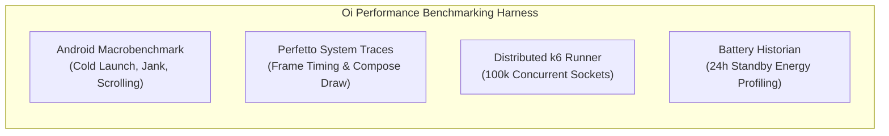

# Performance Testing & Benchmarking Specification: Oi

> **Document ID:** PERF-015-CORE  
> **Status:** Confirmed Baseline  
> **Last Updated:** 2026-11-07  
> **Project Repository:** `https://github.com/shanuthchimbli/oisocialapp`  
> **Author:** Performance Architect & Systems Optimization Lead  
> **Traceability Upstream:** [`docs/01_PRODUCT_REQUIREMENTS.md`](file:///Users/shanuthchimbli/.gemini/antigravity/scratch/oisocialapp/docs/01_PRODUCT_REQUIREMENTS.md) (`PRD-012`), [`docs/04_NON_FUNCTIONAL_REQUIREMENTS.md`](file:///Users/shanuthchimbli/.gemini/antigravity/scratch/oisocialapp/docs/04_NON_FUNCTIONAL_REQUIREMENTS.md)  

---

## 1. Executive Summary & Performance Mandate

Speed is **Oi**'s primary engineering objective. The application must feel instantaneous, fluid, and lightweight across both budget and flagship devices. This specification defines the automated benchmarking harness, profiling methodologies, and latency enforcement gates.



---

## 2. Client-Side Performance Test Methodology

### 2.1 Cold Launch Benchmark (`PERF-001`)
- **Target Budget:** p50 $< 600\text{ ms}$, p95 $< 800\text{ ms}$, Hard Cap $\le 1{,}000\text{ ms}$.
- **Test Baseline Device:** Physical **Pixel 4a** (Snapdragon 730G, 6GB RAM) or low-end MediaTek Helio G85 device.
- **Test Implementation:**
  ```kotlin
  @RunWith(AndroidJUnit4::class)
  class ColdLaunchBenchmark {
      @get:Rule
      val benchmarkRule = MacrobenchmarkRule()

      @Test
      fun measureColdLaunch() = benchmarkRule.measureRepeated(
          packageName = "chat.oi.app",
          metrics = listOf(StartupTimingMetric()),
          iterations = 10,
          startupMode = StartupMode.COLD
      ) {
          pressHome()
          startActivityAndWait()
          device.wait(Until.hasObject(By.res("conversation_list")), 2_000)
      }
  }
  ```

### 2.2 UI Scroll Jank & Frame Budget (`PERF-007`)
- **Target:** 0 jank frames; 60 FPS minimum ($\le 16.6\text{ ms}$ per frame) on 60 Hz displays; 120 FPS ($\le 8.3\text{ ms}$) on 120 Hz displays.
- **Macrobenchmark Rule:** `FrameTimingMetric()` executed across a 5,000-pixel fling gesture on a 500-item conversation list.

---

## 3. Server-Side Load & Concurrency Benchmark

### 3.1 Gateway Concurrency Target (100,000 Sockets per Node)
- **Harness:** Distributed **k6** cluster simulating 100,000 persistent WebSocket connections over TLS 1.3.
- **Load Profile:**
  1. Ramp up: 0 to 100,000 connections over 10 minutes.
  2. Steady state: Sustain 100,000 connections for 30 minutes with heartbeat ping/pong every 30 seconds.
  3. Active messaging: 5% of sockets actively transmitting 1 message per second.
- **Acceptance Criteria:**
  - Gateway pod memory consumption $\le 200\text{ MB}$.
  - CPU utilization $\le 45\%$ across 4 vCPUs.
  - End-to-end message relay latency $\text{p95} \le 350\text{ ms}$.

---

## 4. Performance Regression Enforcement in CI

1. **Automated CI Comparison:** Every release candidate executes the Macrobenchmark suite against the baseline master branch.
2. **Regression Threshold:** If cold launch time increases by $> 50\text{ ms}$ or jank frames exceed $0.5\%$, the CI quality gate automatically **fails the build**, blocking release.
