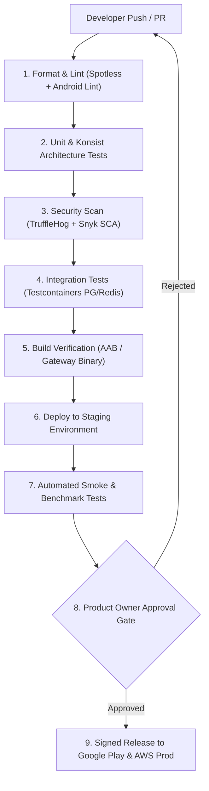

# Automated CI/CD Pipeline & DevOps Automation Specification: Oi

> **Document ID:** DEVOPS-017-CORE  
> **Status:** Confirmed Baseline  
> **Last Updated:** 2026-11-07  
> **Project Repository:** `https://github.com/shanuthchimbli/oisocialapp`  
> **Author:** DevOps Lead & Release Automation Engineer  
> **Automation Engine:** GitHub Actions & Terraform Cloud  
> **Traceability Upstream:** [`docs/01_PRODUCT_REQUIREMENTS.md`](file:///Users/shanuthchimbli/.gemini/antigravity/scratch/oisocialapp/docs/01_PRODUCT_REQUIREMENTS.md), [`docs/16_CODE_QUALITY.md`](file:///Users/shanuthchimbli/.gemini/antigravity/scratch/oisocialapp/docs/16_CODE_QUALITY.md)  

---

## 1. Executive Summary & Automation Vision

The **Oi** Continuous Integration and Continuous Deployment (CI/CD) pipeline is designed for complete automation, eliminating manual, error-prone release steps. The pipeline enforces strict security, code quality, and performance gates, while leaving final production deployment control firmly in the hands of the **Product Owner**.



---

## 2. GitHub Actions Workflow Architecture

### 2.1 Pull Request & Build Verification Workflow (`.github/workflows/ci.yml`)
- **Triggers:** Pull requests to `main` and pushes to feature branches.
- **Jobs:**
  1. `validate-formatting`: Executes `./gradlew spotlessCheck`.
  2. `static-analysis`: Executes `./gradlew lintRelease detekt`.
  3. `unit-tests`: Executes `./gradlew testReleaseUnitTest` and Konsist architecture assertions.
  4. `security-audit`: Runs TruffleHog secrets scan and Snyk dependency scan.
  5. `build-aab`: Generates unsigned Android App Bundle (AAB) to verify zero compilation or ProGuard mapping regressions.

### 2.2 Staging & Production Release Workflow (`.github/workflows/release.yml`)
- **Triggers:** Git release tags (e.g., `v1.0.0-rc1`, `v1.0.0`).
- **Cryptographic Signing:**
  - Android Release Keystore is stored as a base64 string in GitHub Encrypted Secrets (`ANDROID_KEYSTORE_BASE64`).
  - Decoded into volatile memory during the runner job, signed via `jarsigner` / `apksigner`, and immediately zeroized.
- **Production Gate:** Configured via GitHub Protected Environment (`production`) requiring manual review and sign-off by the **Product Owner**.
- **Play Store Deployment:** Automated upload to Google Play Console Internal Track via official Google Play Developer API action.

---

## 3. Infrastructure as Code (IaC) Pipeline

All cloud infrastructure is managed via **Terraform**:
```bash
# Automated Terraform Validation in CI
terraform fmt -check
terraform init -backend=false
terraform validate
tflint
```
Zero manual cloud console configuration is permitted.
