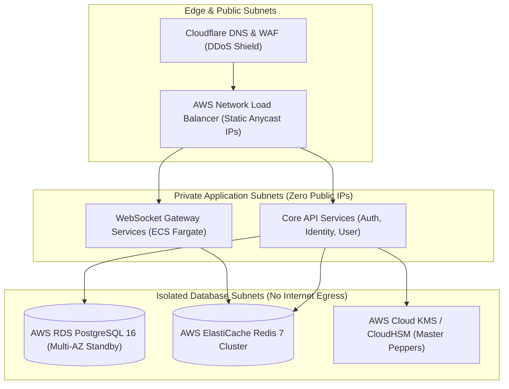

# Infrastructure Topology, Environments & Operational Cost Ledger: Oi

> **Document ID:** INFRA-018-CORE  
> **Status:** Confirmed Baseline  
> **Last Updated:** 2026-11-07  
> **Project Repository:** `https://github.com/shanuthchimbli/oisocialapp`  
> **Author:** Cloud Architect & FinOps Engineer  
> **Primary Cloud Provider:** AWS (Alternative: GCP) & Cloudflare  
> **Traceability Upstream:** [`docs/08_SYSTEM_ARCHITECTURE.md`](file:///Users/shanuthchimbli/.gemini/antigravity/scratch/oisocialapp/docs/08_SYSTEM_ARCHITECTURE.md)  

---

## 1. Multi-Environment Architecture

The infrastructure is segmented into four strictly isolated environments:

| Environment | Purpose | Hosting Topology | Data Persistence |
| :--- | :--- | :--- | :--- |
| **Local Dev** | Rapid iteration & offline development | Docker Compose (PostgreSQL 16, Redis 7, LocalStack) | Volatile local volume |
| **CI / Testing** | Automated PR verification | Ephemeral GitHub Actions runners + Testcontainers | Destroyed on run completion |
| **Staging** | Pre-production validation & performance benchmarking | AWS ECS Fargate (2 Gateway pods, 1 Auth pod, RDS single-AZ, ElastiCache) | Sanitized mock data |
| **Production** | Live consumer traffic | AWS Multi-AZ ECS Fargate / EKS, RDS PostgreSQL Multi-AZ, ElastiCache Cluster | Encrypted live data with PITR |

---

## 2. Infrastructure as Code (Terraform Topology)

---

## 3. Financial & Operational Cost Ledger

> [!NOTE]
> All unit prices represent verified 2026 commercial tier estimates. Costs marked *(Usage)* scale directly with active monthly users.

### 3.1 One-Time Registration & Platform Fees
| Item | Provider | Purpose | Estimated Cost | Ownership |
| :--- | :--- | :--- | :---: | :--- |
| **Google Play Console Account** | Google | One-time developer registration fee | **$25.00** | Product Owner |
| **Apple Developer Program** | Apple | iOS distribution membership (Phase 2) | **$99.00 / year** | Product Owner |
| **Domain Registration (`oi.chat`)** | Cloudflare Registrar | Primary application domain & DNS | **$12.00 / year** | Product Owner |

### 3.2 Monthly Baseline Fixed Infrastructure (Production Tier-1)
| Component | Resource Specification | Provider | Monthly Cost |
| :--- | :--- | :--- | :---: |
| **ECS Fargate Compute** | 4 Gateway tasks + 2 API tasks (2 vCPU, 4 GB RAM each) | AWS | ~$140.00 |
| **RDS PostgreSQL Multi-AZ** | `db.t4g.medium` (2 vCPU, 4 GB RAM, 50 GB gp3 SSD) | AWS | ~$75.00 |
| **ElastiCache Redis Cluster** | `cache.t4g.small` (Primary + 1 Read Replica) | AWS | ~$35.00 |
| **Network Load Balancer** | AWS NLB (L4 TCP/TLS) | AWS | ~$22.00 |
| **Cloud KMS / HSM** | Master Pepper key management & rotation | AWS | ~$5.00 |
| **GitHub Actions / CI Runners** | GitHub Pro (3,000 minutes build pipeline) | GitHub | ~$4.00 |
| **Monitoring & Logging** | Prometheus / Grafana Cloud (Free Tier up to 10k metrics) | Grafana Labs | $0.00 (Free Tier) |
| **Total Monthly Baseline Fixed:** | | | **~$291.00 / month** |

### 3.3 Variable & Usage-Based Expenses (Per 10,000 Active Users)
| Service | Consumption Metric | Unit Rate (2026 Market Rates) | Est. Cost / 10k Users |
| :--- | :--- | :--- | :---: |
| **SMS OTP Verification (India)** | 1 OTP per registration | ~₹0.15 per SMS (~$0.0018) | ~$18.00 |
| **SMS OTP Verification (UK)** | 1 OTP per registration | ~£0.035 per SMS (~$0.044) | ~$440.00 |
| **SMS OTP Verification (USA)** | 1 OTP per registration | ~$0.0079 per SMS | ~$79.00 |
| **UIDAI Offline XML Verification** | Resident downloads from portal | **$0.00** (Statutory free resident service) | **$0.00** |
| **Push Notifications (FCM / APNs)** | Data-only push pings | **$0.00** (Free platform service) | **$0.00** |

---

## 4. Master Account Ownership Checklist

The **Product Owner** must retain 100% root ownership and executive control over all external service accounts:
- [ ] **AWS Root Account:** Registered to `productowner@oi.chat` with hardware FIDO2 MFA.
- [ ] **Google Play Console:** Registered to Product Owner Google Account.
- [ ] **GitHub Organization:** Organization Owner with SAML/MFA enforcement.
- [ ] **Twilio / AWS SNS SMS Account:** Root billing owned by Product Owner.
- [ ] **Cloudflare DNS Account:** Primary registrar and nameserver management.
