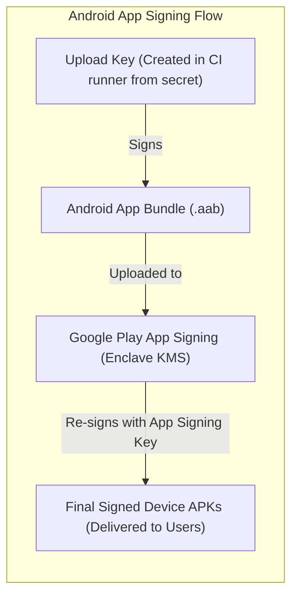
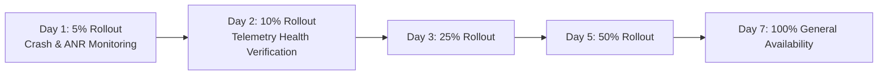

# Deployment, Release Engineering & Rollback Runbook: Oi

> **Document ID:** REL-019-CORE  
> **Status:** Confirmed Baseline  
> **Last Updated:** 2026-11-07  
> **Project Repository:** `https://github.com/shanuthchimbli/oisocialapp`  
> **Author:** Release Engineer & Mobile DevOps Lead  
> **Traceability Upstream:** [`docs/01_PRODUCT_REQUIREMENTS.md`](file:///Users/shanuthchimbli/.gemini/antigravity/scratch/oisocialapp/docs/01_PRODUCT_REQUIREMENTS.md), [`docs/17_CI_CD_PIPELINE.md`](file:///Users/shanuthchimbli/.gemini/antigravity/scratch/oisocialapp/docs/17_CI_CD_PIPELINE.md)  

---

## 1. Executive Summary & Governance Invariant

No production release of the **Oi** mobile application or backend services may occur without explicit, documented approval from the **Product Owner**.

This runbook establishes:
1. Android cryptographic signing procedures.
2. Version numbering standards.
3. Staged Play Store rollout schedules.
4. Emergency rollback triggers.
5. Zero-downtime database migration runbooks.

---

## 2. Android Cryptographic Application Signing



### 2.1 Keystore Ownership & Protection
- **Root Keystore Generation:** Created on an air-gapped machine using:
  ```bash
  keytool -genkey -v -keystore oi-release-upload.jks -alias oi-upload -keyalg RSA -keysize 4096 -validity 10000
  ```
- **Physical Backup:** The original keystore file and passphrase are stored on two encrypted USB drives retained in physical safes owned by the **Product Owner**.
- **Upload Key Strategy:** Google Play App Signing is enabled. The Google Play Console holds the master application signing key; the CI/CD pipeline holds only the Upload Key. If the CI key is ever compromised, it can be revoked and re-registered via Play Console without abandoning the app.

---

## 3. Versioning Scheme

- **User-Facing Version Name (`versionName`):** Strict Semantic Versioning `MAJOR.MINOR.PATCH` (e.g., `1.0.0`, `1.0.1`).
- **Internal Version Code (`versionCode`):** Integer constructed via date-based numbering `YYYYMMDDXX` (e.g., `2026110701` for build 01 on Nov 7, 2026). Guarantees strictly monotonic progression.

---

## 4. Staged Production Rollout Framework

All production updates to the Google Play Store execute via an automated **Staged Rollout**:



### 4.1 Automatic Halt & Rollback Triggers
A staged rollout is **immediately halted** if telemetry detects any of the following within a 1-hour window:
1. **Crash-Free Session Rate:** Drops below **99.8%** (Crash rate $> 0.2\%$).
2. **ANR (Application Not Responding) Rate:** Exceeds **0.1%**.
3. **Cold Launch Latency p95:** Exceeds **1,000 ms**.
4. **WebSocket Connection Failure Rate:** Exceeds **0.5%**.

---

## 5. Zero-Downtime Database Migration Protocol

Database schema changes follow the **Expand and Contract (Parallel Run)** pattern:

```mermaid
sequenceDiagram
    autonumber
    participant DBA as Database Migration Runner
    participant PG as PostgreSQL 16
    participant App_Old as Active Backend v1.0
    participant App_New as New Backend v1.1

    Note over DBA,PG: Phase 1: Expand (Additive Schema Only)
    DBA->>PG: ALTER TABLE users ADD COLUMN new_column ... (Nullable or with default)
    Note over App_Old,PG: v1.0 continues writing; ignores new_column
    
    Note over App_New,PG: Phase 2: Deploy New Backend
    DBA->>App_New: Deploy v1.1 pods; starts reading & writing new_column
    
    Note over DBA,PG: Phase 3: Contract (Cleanup)
    DBA->>PG: Drop deprecated columns / constraints after v1.0 is 100% retired
```
Zero table-locking DDL statements (`ALTER TABLE ... ADD CONSTRAINT ... NOT VALID`) are used to eliminate downtime.
