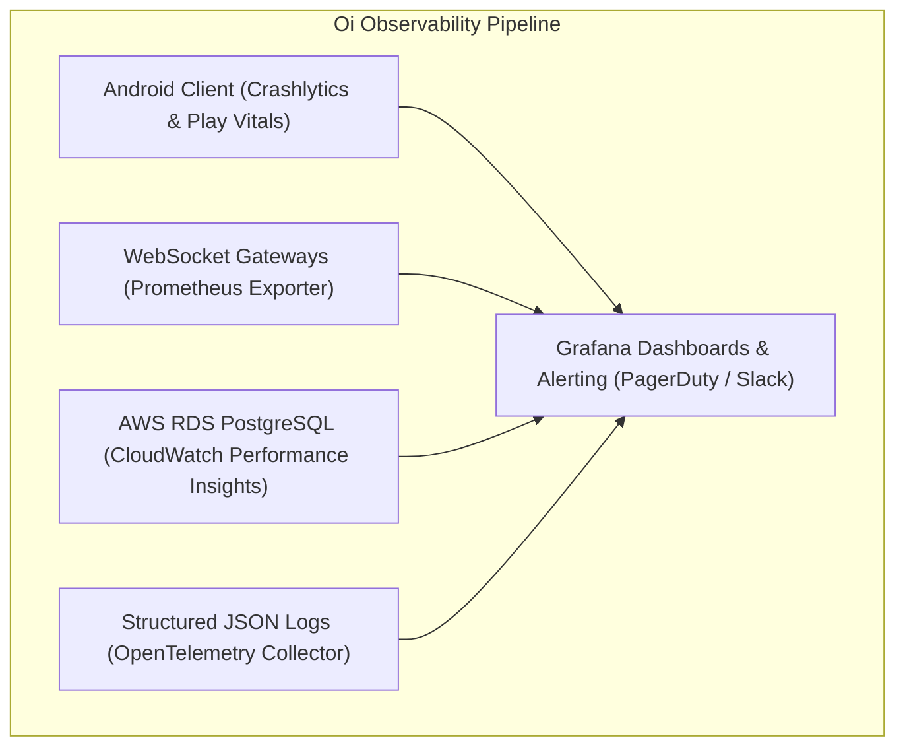

# Telemetry, Observability & Site Reliability Maintenance: Oi

> **Document ID:** SRE-020-CORE  
> **Status:** Confirmed Baseline  
> **Last Updated:** 2026-11-07  
> **Project Repository:** `https://github.com/shanuthchimbli/oisocialapp`  
> **Author:** Site Reliability Engineer & Operations Lead  
> **Telemetry Stack:** OpenTelemetry, Prometheus, Grafana, Google Play Vitals  
> **Traceability Upstream:** [`docs/01_PRODUCT_REQUIREMENTS.md`](file:///Users/shanuthchimbli/.gemini/antigravity/scratch/oisocialapp/docs/01_PRODUCT_REQUIREMENTS.md), [`docs/04_NON_FUNCTIONAL_REQUIREMENTS.md`](file:///Users/shanuthchimbli/.gemini/antigravity/scratch/oisocialapp/docs/04_NON_FUNCTIONAL_REQUIREMENTS.md)  

---

## 1. Executive Summary & Telemetry Principles

The **Oi** observability architecture provides deep, actionable real-time insight into system health while upholding an unbending privacy guarantee: **Zero plaintexts, zero conversation content, and zero citizen identity records ever enter telemetry systems, log streams, or metrics pipelines**.

---

## 2. Core Service-Level Objective (SLO) Metrics & Alerts

| Metric Identifier | Monitored Component | Measurement Target | Warning Threshold | Critical Alert (PagerDuty) |
| :--- | :--- | :---: | :---: | :---: |
| `SLO-LAT-001` | WebSocket Message Transit | $\text{p95} < 350\text{ ms}$ | $\text{p95} > 450\text{ ms}$ for 5m | $\text{p95} > 600\text{ ms}$ for 2m |
| `SLO-CON-001` | Gateway Connection Uptime | $99.95\%$ connected | Drop of $1\%$ active conns | Drop of $> 5\%$ conns in 1m |
| `SLO-OTP-001` | SMS Delivery Success Rate | $\ge 95\%$ delivered | $< 90\%$ over 10m | $< 80\%$ over 5m (SMS Gateway Down) |
| `SLO-CRASH-001`| Android Crash-Free Rate | $\ge 99.8\%$ sessions | $< 99.5\%$ | $< 99.0\%$ (Trigger Rollout Halt) |
| `SLO-DB-001` | RDS CPU Utilization | $\le 40\%$ | $> 65\%$ for 10m | $> 85\%$ for 5m |
| `SLO-RET-001` | 365-Day Daily Purge Cron | Successful run @ 03:00 | Job duration $> 30\text{ mins}$ | Job failure / missed execution |

---

## 3. Incident Severity Matrix & Response SLA

| Severity Level | Operational Impact | Response SLA | Target Resolution | Escalation Authority |
| :---: | :--- | :---: | :---: | :--- |
| **SEV-1 (Critical)** | Core messaging offline; database unreachable; active exploit detected. | **$< 15\text{ mins}$** | $< 2\text{ hours}$ | Lead Architect & Product Owner |
| **SEV-2 (Major)** | SMS OTP gateway failing in one region; elevated crash rate on specific OS version. | **$< 30\text{ mins}$** | $< 6\text{ hours}$ | Lead Developer |
| **SEV-3 (Moderate)**| Performance degradation on search; delayed status updates. | **$< 4\text{ hours}$** | $< 24\text{ hours}$ | On-Call Engineer |
| **SEV-4 (Minor)** | Minor UI cosmetic glitch; non-blocking telemetry drop. | **$< 24\text{ hours}$** | Next Sprint | Standard Backlog |

---

## 4. Single-Developer Practical Maintenance Runbook

To ensure the platform requires minimal ongoing manual attention from a single engineer:

### 4.1 Automated Self-Healing Policies
- **Pod Auto-Restart:** If a WebSocket gateway pod exceeds memory limits or fails `/healthz` for 3 consecutive 5-second intervals, Kubernetes automatically kills and respawns the pod.
- **Auto-Scaling:** Gateway pods horizontally scale out when CPU utilization exceeds 60% or concurrent sockets per pod exceed 85,000.
- **Failover:** AWS RDS Multi-AZ automatically promotes the synchronous standby replica within 60 seconds of hardware degradation.

### 4.2 Weekly Operational Routine (15 Minutes)
1. **Audit Dashboard Inspection:** Review Grafana weekly summary for p95 latency drift and SMS carrier delivery rates.
2. **Review Dependabot Alerts:** Merge automated security patch pull requests verified by CI test suites.
3. **Verify Daily Purge Verification Logs:** Confirm that the 03:00 UTC retention worker successfully purged eligible records.
4. **Cloud Cost Review:** Inspect AWS Cost Explorer against the monthly budget ($300 baseline).
