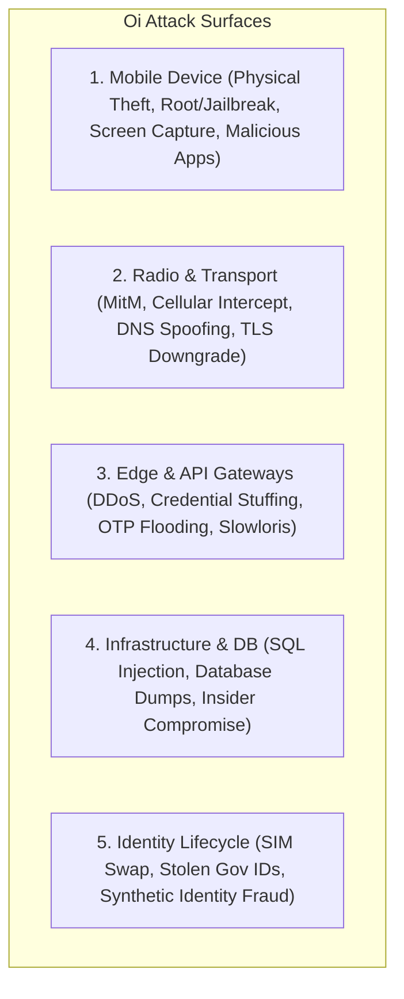

# Comprehensive STRIDE Threat Model & Security Risk Catalog: Oi

> **Document ID:** THREAT-021-CORE  
> **Status:** Confirmed Baseline  
> **Last Updated:** 2026-11-07  
> **Project Repository:** `https://github.com/shanuthchimbli/oisocialapp`  
> **Author:** Lead Security Architect & Penetration Testing Lead  
> **Methodology:** Microsoft STRIDE Threat Model, OWASP ASVS v4.0, NIST SP 800-30  
> **Traceability Upstream:** [`docs/01_PRODUCT_REQUIREMENTS.md`](file:///Users/shanuthchimbli/.gemini/antigravity/scratch/oisocialapp/docs/01_PRODUCT_REQUIREMENTS.md), [`docs/06_SECURITY_AND_PRIVACY.md`](file:///Users/shanuthchimbli/.gemini/antigravity/scratch/oisocialapp/docs/06_SECURITY_AND_PRIVACY.md)  

---

## 1. Executive Summary & Attack Surface Overview

The **Oi** threat model systematically identifies, classifies, and mitigates security threats across all tiers of the platform: the Android client runtime, wireless transport networks, API gateways, database persistence layers, and identity verification integrations.

---

## 2. STRIDE Threat Matrix & Detailed Analysis

### TM-001: SIM Swapping Attack (Spoofing / Account Takeover)
- **Threat Description:** An adversary executes an unauthorized SIM swap via a compromised mobile telecom carrier store, gaining temporary control of the victim's mobile phone number to intercept SMS OTP codes.
- **Attack Surface:** Cellular SMS delivery network and OTP authentication endpoint (`/v1/auth/phone/otp-verify`).
- **Potential Impact:** High. The adversary could authenticate as the victim's phone number.
- **Mitigation Strategy:**
  1. Authenticating on a new device triggers **mandatory sovereign identity re-verification**. Possession of the SIM alone does not permit account restoration.
  2. If the user cannot prove cryptographic ownership of the sovereign identity token (Aadhaar offline XML share code or biometric/mDL assertion), the session is rejected.
  3. A 72-hour security hold is placed on sensitive profile operations whenever a device switch occurs without identity re-proof.
- **Detection Mechanism:** GeoIP velocity anomaly detection; carrier SIM IMSI change signals where supported by telecom network APIs.
- **Testing Method:** Automated simulation test verifying OTP validation on Device B cannot access account without sovereign re-verification.
- **Residual Risk:** Low. SIM swap alone fails to compromise the account.

---

### TM-002: Stolen Government Credentials / Duplicate Identity Registration (Spoofing)
- **Threat Description:** An attacker steals a legitimate citizen's physical identity card or downloaded Aadhaar XML and attempts to register a fraudulent Oi account.
- **Attack Surface:** Identity verification submission endpoint (`/v1/identity/verify`).
- **Potential Impact:** Critical. Fraudulent verified account created in victim's name.
- **Mitigation Strategy:**
  1. India: Aadhaar XML is encrypted with a resident-specified 4-digit share code and valid only for 72 hours.
  2. USA/UK: Verification requires live interactive biometric liveness check (Passive Liveness ISO/IEC 30107-3) matching the photo extracted from the sovereign record.
  3. Enforced One-Person-One-Account: If the victim is already registered, the Blinded Identity Nullifier collision (`ERR_IDENTITY_DUPLICATE`) blocks the duplicate attempt immediately.
- **Detection Mechanism:** Immediate alert dispatched to the existing verified user via in-app notification and SMS: *"An unauthorized attempt to register using your verified identity was blocked."*
- **Testing Method:** Penetration test attempting to submit previously registered nullifier token.
- **Residual Risk:** Low.

---

### TM-003: SMS OTP Brute-Forcing & Interception (Tampering / Spoofing)
- **Threat Description:** An attacker scripts rapid parallel submissions of 6-digit OTP codes ($10^6$ combinations) or floods the SMS gateway.
- **Attack Surface:** `/v1/auth/phone/otp-verify` and `/v1/auth/phone/otp-request`.
- **Potential Impact:** High. Unauthorized account creation or denial-of-service toll fraud.
- **Mitigation Strategy:**
  1. Maximum 3 incorrect OTP attempts per session; session is locked for 15 minutes after 3rd failure.
  2. Rate limiting enforced via Redis token bucket: maximum 3 OTP dispatches per phone number per hour.
  3. OTP tokens expire strictly after 300 seconds (5 minutes).
- **Detection Mechanism:** Real-time Redis metrics tracking failed OTP submission rates; automated IP blacklisting upon threshold breach.
- **Testing Method:** Burp Suite intruder attack attempting 1,000 requests against single OTP session.
- **Residual Risk:** Very Low. Probability of guessing 6-digit code in 3 tries is $3 / 1{,}000{,}000 = 0.0003\%$.

---

### TM-004: Central Database Dump / Infrastructure Breach (Information Disclosure)
- **Threat Description:** An external adversary gains root access to the PostgreSQL database cluster or an AWS RDS snapshot is inadvertently leaked.
- **Attack Surface:** Cloud PostgreSQL database storage, WAL logs, and snapshot backups.
- **Potential Impact:** Catastrophic in conventional apps; mitigated to negligible in Oi.
- **Mitigation Strategy:**
  1. **Zero Plaintext:** The database contains zero message plaintext. All message tables store opaque ciphertext encrypted via Signal Double Ratchet.
  2. **Zero Raw Citizen IDs:** The database contains no Aadhaar numbers, SSNs, or passport numbers. Only salted, irreversible HMAC-SHA256 nullifiers are persisted.
  3. Master HMAC salts are stored exclusively in hardware Cloud HSM, never in database tables.
- **Detection Mechanism:** AWS GuardDuty database anomaly monitoring; PostgreSQL pgAudit extension logging unauthorized table exports.
- **Testing Method:** Offline decryption test of raw database dump using compromised server credentials. Plaintext recovery must fail.
- **Residual Risk:** Very Low. Ciphertext cannot be decrypted without client-side hardware keystore keys.

---

### TM-005: Rogue Employee / Malicious Insider Threat (Information Disclosure / Tampering)
- **Threat Description:** A systems administrator or rogue employee attempts to eavesdrop on private user chats or manually reassign account handles.
- **Attack Surface:** Internal Kubernetes clusters, administrative bastions, and production server consoles.
- **Potential Impact:** High in conventional architectures.
- **Mitigation Strategy:**
  1. **No Employee Backdoor:** The Double Ratchet cryptographic protocol mathematically denies access to server operators. Plaintext does not exist on servers.
  2. Zero manual override consoles: Production services possess no API endpoints or administrative screens for transferring usernames or overriding verification badges.
  3. Bastion access requires hardware FIDO2 WebAuthn keys with mandatory 4-eyes approval and immutable audit logging.
- **Detection Mechanism:** Immutable audit logging to append-only AWS CloudTrail bucket with real-time alerting.
- **Testing Method:** Internal penetration test verifying whether administrative credentials can decrypt message traffic or force account state changes.
- **Residual Risk:** Negligible for message content; Low for service availability.

---

### TM-006: Man-in-the-Middle (MitM) & Radio Interception (Information Disclosure / Tampering)
- **Threat Description:** An attacker controls a rogue Wi-Fi access point or compromised cellular base station (Stingray / IMSI catcher) and attempts TLS interception.
- **Attack Surface:** Wireless transmission interface between Android client and WebSocket gateway.
- **Potential Impact:** Critical if unmitigated.
- **Mitigation Strategy:**
  1. Mandatory **TLS 1.3** with certificate pinning (HPKP) enforced in OkHttp.
  2. Any unrecognized CA, self-signed proxy certificate (e.g., Charles Proxy, Burp Suite), or expired cert causes immediate connection termination.
  3. Even if TLS were broken, the underlying payload is encrypted with Signal Double Ratchet keys bound to hardware TEE.
- **Detection Mechanism:** Client reports certificate pinning failure telemetry over out-of-band endpoint if reachable.
- **Testing Method:** Dynamic instrumentation testing with MitM proxy in place; app must refuse all network transmission.
- **Residual Risk:** Negligible.

---

### TM-007: Lost or Stolen Physical Device (Elevation of Privilege / Information Disclosure)
- **Threat Description:** An adversary gains physical possession of a user's unlocked or locked Android smartphone.
- **Attack Surface:** Physical device storage, USB debugging / ADB, cold-boot attack.
- **Potential Impact:** Medium to High.
- **Mitigation Strategy:**
  1. Local Room database is encrypted using **SQLCipher (256-bit AES)** with keys protected by hardware Android Keystore (StrongBox Keymaster).
  2. App supports optional Biometric / PIN unlock on launch.
  3. Sensitive screens enforce `FLAG_SECURE`, blocking screenshot capture and background task previews.
  4. Remote Invalidation: The moment the user logs into their account on a new phone, the server dispatches a high-priority FCM push causing the stolen device to permanently erase all local cryptographic keys and databases.
- **Detection Mechanism:** User-initiated remote login on replacement hardware.
- **Testing Method:** Attempting to extract SQLite databases from rooted/unrooted test devices via ADB shell. Files must be unreadable ciphertext.
- **Residual Risk:** Low.

---

### TM-008: Username Impersonation & Squatting (Spoofing)
- **Threat Description:** A malicious actor claims usernames of famous individuals, brands, or system roles (`@official_police`, `@oi_support`, `@elonmusk`) to deceive contacts.
- **Attack Surface:** Username registration and update endpoints (`/v1/users/username-check`, `/v1/users/username-update`).
- **Potential Impact:** Medium. Phishing or trust degradation.
- **Mitigation Strategy:**
  1. Comprehensive reserved word blacklist (250+ terms) hardcoded in database triggers.
  2. **180-Day Quarantine Policy:** Abandoned usernames cannot be claimed immediately by third parties.
  3. Every account displays their sovereign verification badge; unverified handles cannot initiate bulk outreach.
- **Detection Mechanism:** Automated fuzzy string matching (Levenshtein distance) detecting typosquatting attempts of high-risk keywords.
- **Testing Method:** Automated unit tests attempting registration of reserved and typographical variants.
- **Residual Risk:** Low.

---

### TM-009: Supply-Chain & Third-Party Dependency Poisoning (Tampering)
- **Threat Description:** A compromised open-source library or poisoned Gradle dependency injects malicious telemetry or backdoors into the Android client.
- **Attack Surface:** Gradle build pipeline and third-party dependencies.
- **Potential Impact:** High.
- **Mitigation Strategy:**
  1. **Minimalist Architecture:** The app eliminates bloated media SDKs. Third-party libraries are limited to Google Jetpack libraries, Kotlin Coroutines, SQLCipher, and certified Signal crypto bindings.
  2. Strict dependency locking (`gradle.lockfile`) with SHA-256 integrity checksum verification.
  3. Automated software composition analysis (SCA) via GitHub Dependabot and Snyk in CI/CD pipeline.
- **Detection Mechanism:** Continuous vulnerability scanning in GitHub Actions blocking PR merges on flagged CVEs.
- **Testing Method:** CI/CD dependency scan with artificially injected compromised artifact version.
- **Residual Risk:** Low.

---

## 3. Threat Assessment Summary Table

| Threat ID | Threat Name | STRIDE Category | Pre-Mitigation Risk | Post-Mitigation Risk | Primary Defense |
| :---: | :--- | :---: | :---: | :---: | :--- |
| **TM-001** | SIM Swap Account Takeover | Spoofing | **High** | **Low** | Mandatory Sovereign Re-Verification |
| **TM-002** | Stolen Citizen ID Registration | Spoofing | **Critical** | **Low** | 72h XML Share Code + Liveness + OPOA Hash |
| **TM-003** | SMS OTP Brute-Forcing | Tampering | **High** | **Very Low** | 3 Attempts Cap + Redis Rate Limiter |
| **TM-004** | Cloud Database Breach | Info Disclosure | **Critical** | **Very Low** | Zero Plaintext E2EE + Salted Nullifiers |
| **TM-005** | Malicious Insider Threat | Info Disclosure | **High** | **Negligible** | No Backdoor + End-to-End Cryptography |
| **TM-006** | Transport MitM Eavesdropping | Info Disclosure | **High** | **Negligible** | TLS 1.3 Strict Pinning + Double Ratchet |
| **TM-007** | Physical Device Theft | Elevation of Priv | **Medium** | **Low** | SQLCipher + StrongBox + Remote Wipe |
| **TM-008** | Handle Squatting & Impersonation | Spoofing | **Medium** | **Low** | 180-day Quarantine + Reserved Blacklist |
| **TM-009** | Supply-Chain Poisoning | Tampering | **High** | **Low** | Minimalist Deps + Checksum Verification |
